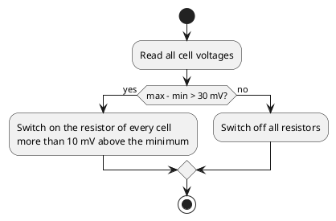
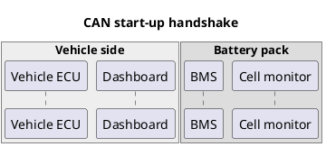
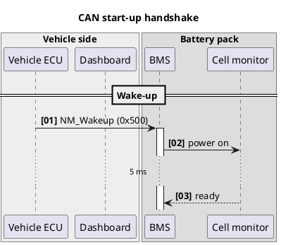
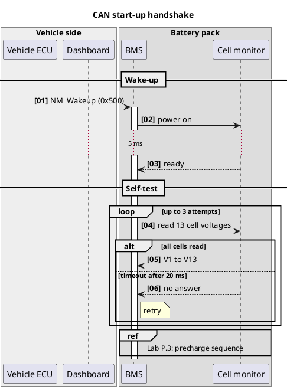
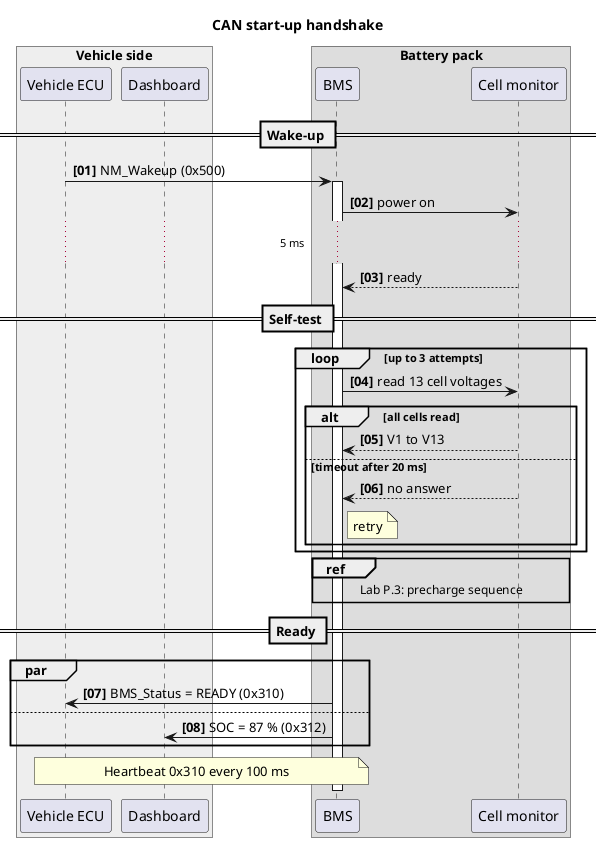
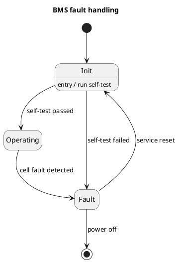
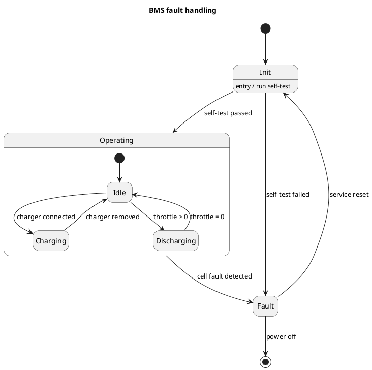
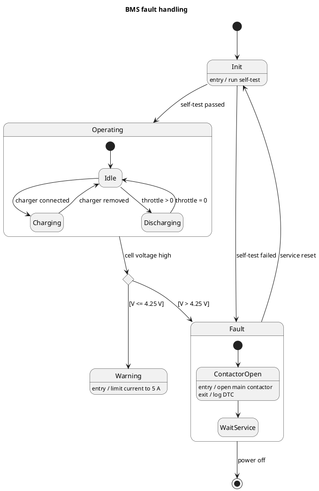
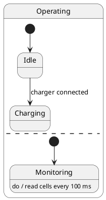
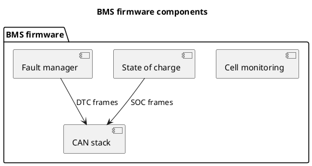

# Day 2: deep-dive labs


Docs-as-Code and PTC Codebeamer ALM, by Jeganathan Swaminathan (TekTutor Press)


## Today's agenda

### 1. Writing for Git: AsciiDoc, PlantUML, and best practices

- AsciiDoc overview
- PlantUML overview: sequence, class, component, state, and deployment diagrams
- Best practices: one sentence per line for clean diffs, semantic line breaks, diagrams as text instead of binary images
- Hands-on: a reST page with a table, a cross-reference, and a PlantUML diagram (Lab D.2)
- Hands-on: convert a real README to reST (Lab D.3)
- Hands-on: two writers on one repository (Labs D.1 and D.1b)
- Hands-on: sequence, state, component, and deployment diagrams, one shared style, and a diagram generated from data (Labs D.6 to D.10)
- Hands-on: rewrite the same page in AsciiDoc (Labs D.4 and D.5)

### 2. Sphinx fundamentals

- Project anatomy: `conf.py`, `index.rst`, `toctree`, `_static`, `_build`
- Building HTML and PDF output
- Switching themes and configuring extensions
- Cross-referencing and labels
- Hands-on: build a Sphinx project with `sphinx-quickstart`, break and fix a build in strict mode (Lab D.11)
- Hands-on: one source for two products (Lab D.12), and real code in the docs (Lab D.13)
- Hands-on: switch themes between `sphinx-rtd-theme` and Furo (Lab D.14)
- Hands-on: generate PDF output from the same source (Lab D.15)

### 3. SphinxNeeds

- Typed need objects: requirements, specifications, test cases
- Core directives: `req`, `spec`, `test` with IDs, status, and tags
- Linking needs for traceability
- Filtering and visualization: `needtable`, `needflow`, `needpie`, `needlist`
- Hands-on: add requirements, specifications, and tests, link them, and draw the traceability graph (Lab D.16)
- Hands-on: rules that stop the build when a need is incomplete (Lab D.17)

### 4. SphinxNeeds for real work

- Full traceability matrix from requirement to test
- Status roll-ups and coverage gaps
- Linking needs to source files and test results
- Hands-on: real test results in the documentation (Lab D.18)
- Hands-on: a coverage view that flags requirements without tests (Lab D.19)

### 5. Continuous integration for documentation

- Automated builds, testing, and deployment for docs
- What testing means for docs: strict build, link check, spell check
- Deployment targets: GitHub Pages, internal server, build artifact
- Hands-on: make a build fail on a broken reference, add spell checking with a project word list, and check the GitHub Actions workflow (Lab D.20)

## Before you start

```bash
source ~/dac-venv/bin/activate
sphinx-build --version      # sphinx-build 9.1.0
plantuml -version | head -n 1
asciidoctor --version | head -n 1
```

## Labs

| Lab | Title |
|---|---|
| [Lab D.1](#lab-d1---one-sentence-per-line-proven-with-git) | One sentence per line, proven with Git |
| [Lab D.1b](#lab-d1b---two-writers-two-laptops-one-shared-repository) | Two writers, two laptops, one shared repository |
| [Lab D.2](#lab-d2---a-rich-rest-page-cell-balancing) | A rich reST page: cell balancing |
| [Lab D.3](#lab-d3---convert-a-real-readme-to-rest-and-fix-what-pandoc-gets-wrong) | Convert a real README to reST, and fix what Pandoc gets wrong |
| [Lab D.4](#lab-d4---one-asciidoc-source-for-two-products) | One AsciiDoc source for two products |
| [Lab D.5](#lab-d5---the-same-page-in-asciidoc-and-what-you-learn-from-it) | The same page in AsciiDoc, and what you learn from it |
| [Lab D.6](#lab-d6---draw-the-can-start-up-handshake) | Draw the CAN start-up handshake |
| [Lab D.7](#lab-d7---model-the-bms-fault-handling-as-a-state-machine) | Model the BMS fault handling as a state machine |
| [Lab D.8](#lab-d8---give-every-diagram-the-same-style-from-one-file) | Give every diagram the same style from one file |
| [Lab D.9](#lab-d9---draw-the-component-and-deployment-views) | Draw the component and deployment views |
| [Lab D.10](#lab-d10---generate-a-diagram-from-data-and-publish-it-with-sphinx) | Generate a diagram from data, and publish it with Sphinx |
| [Lab D.11](#lab-d11---a-multi-page-operator-manual) | A multi-page operator manual |
| [Lab D.12](#lab-d12---one-source-two-products) | One source, two products |
| [Lab D.13](#lab-d13---show-real-code-from-the-source-files) | Show real code from the source files |
| [Lab D.14](#lab-d14---switch-and-customise-themes) | Switch and customise themes |
| [Lab D.15](#lab-d15---print-the-manual-as-a-pdf) | Print the manual as a PDF |
| [Lab D.16](#lab-d16---a-safety-chain-as-needs) | A safety chain as needs |
| [Lab D.17](#lab-d17---rules-that-stop-the-build) | Rules that stop the build |
| [Lab D.18](#lab-d18---real-test-results-in-the-documentation) | Real test results in the documentation |
| [Lab D.19](#lab-d19---a-coverage-dashboard) | A coverage dashboard |
| [Lab D.20](#lab-d20---ci-for-the-documentation) | CI for the documentation |

# 1. Writing habits, reStructuredText, and AsciiDoc

```bash
mkdir -p ~/dac-labs/deep/writing
cd ~/dac-labs/deep/writing
source ~/dac-venv/bin/activate
```

## Lab D.1 - One sentence per line, proven with Git

**You build:** Two small repositories, `wrapped` and `semantic`, with the same edits and very different merge results.

### Create a repository with a wrapped paragraph

```bash
mkdir wrapped
cd wrapped
git init -q
```

`protection.rst`

```rst
Over-voltage protection
=======================

The BMS reads all 13 cell voltages every 100 ms. When any cell
stays above 4.25 V for three readings in a row, the BMS opens
the main contactor. It then stores fault code F012 with the
cell number and the voltage. The rider sees a red warning on
the display. Charging is blocked until a technician clears
the fault with the diagnostic tool.
```

```bash
git add protection.rst
git commit -q -m "Add over-voltage protection page"
git log --oneline
```

### Asha changes the second sentence

```bash
git switch -q -c asha
sed -i 's/three readings/two readings/' protection.rst
sed -i 's/opens$/opens both/' protection.rst
sed -i 's/^the main contactor/main contactors/' protection.rst
{ head -n 3 protection.rst; tail -n +4 protection.rst | fmt -w 60; } > tmp.rst && mv tmp.rst protection.rst
cat protection.rst
```

```bash
git commit -q -am "Trip after two readings and open both contactors"
git diff --stat main asha
```

### Ravi changes the fourth sentence

```bash
git switch -q main
git switch -q -c ravi
old='The rider sees a red warning on'
new='The display shows a red battery symbol and'
sed -i "s/$old/$new/" protection.rst
old='^the display. Charging'
new='the text "Battery fault". Charging'
sed -i "s/$old/$new/" protection.rst
{ head -n 3 protection.rst; tail -n +4 protection.rst | fmt -w 60; } > tmp.rst && mv tmp.rst protection.rst
git commit -q -am "Describe the rider warning" --author="Ravi Kumar <ravi.kumar@example.com>"
git diff --stat main ravi
```

### Merge both branches

```bash
git switch -q main
git merge -q asha
git merge ravi    # fails on purpose
```

```bash
git diff
```

```bash
git merge --abort
git status --short
```

### Look at the word-level difference

```bash
git diff asha~1 asha
```

```bash
git diff --word-diff asha~1 asha
```

### Repeat the experiment with one sentence per line

```bash
cd ..
mkdir semantic
cd semantic
git init -q
```

`protection.rst`

```rst
Over-voltage protection
=======================

The BMS reads all 13 cell voltages every 100 ms.
When any cell stays above 4.25 V for three readings in a row, the BMS opens the main contactor.
It then stores fault code F012 with the cell number and the voltage.
The rider sees a red warning on the display.
Charging is blocked until a technician clears the fault with the diagnostic tool.
```

```bash
git add protection.rst
git commit -q -m "Add over-voltage protection page" --author="Meena Iyer <meena.iyer@example.com>"
git switch -q -c asha
sed -i 's/three readings/two readings/' protection.rst
sed -i 's/opens the main contactor/opens both main contactors/' protection.rst
git commit -q -am "Trip after two readings and open both contactors" --author="Asha Rao <asha.rao@example.com>"
git switch -q main
git switch -q -c ravi
old='The rider sees a red warning on the display.'
new='The display shows a red battery symbol and the text "Battery fault".'
sed -i "s/$old/$new/" protection.rst
git commit -q -am "Describe the rider warning" --author="Ravi Kumar <ravi.kumar@example.com>"
git diff --stat main asha
git diff --stat main ravi
```

```bash
git switch -q main
git merge -q asha
git merge -m "Merge branch 'ravi'" ravi
cat protection.rst
```

### Compare git blame

```bash
git blame --date=short protection.rst
```

### Challenge: split an existing page automatically

Goal: write a small Python script `split_sentences.py` that reads an reST file and writes it back with one sentence per line. It must keep titles, underlines, blank lines, and indented blocks (such as directive content) as they are, and only join and split the lines of ordinary paragraphs. Run it on the wrapped `protection.rst` from the first repository and check the result with `git diff --stat`.
Hints:
- Read the file as a list of lines, and collect the lines of one paragraph until you reach a blank line.
- A line that starts with a space, or a line made only of `=`, `-`, or `~`, is not part of an ordinary paragraph.
- Split the joined paragraph after `.`, `!`, or `?` followed by a space, with `re.split(r"(?<=[.!?]) +", text)`.

## Lab D.1b - Two writers, two laptops, one shared repository

**You build:** A bare repository `team.git` that plays the role of GitHub, and two clones, `asha` and `ravi`, each in its own terminal window.

### Give each terminal a title and a colour

```bash
cat >> ~/.bashrc <<'EOF'

# Set the terminal window or tab title: title Asha
title() {
  PS1="${PS1/\\\[\\e\]0;*\\a\\\]/}"   # remove Ubuntu's title
  PS1="\[\e]0;$*\a\]$PS1"            # add your title
}
EOF
source ~/.bashrc
```

```bash
title Asha        # first window
title Ravi        # second window
```

```bash
# Asha's window: green prompt
PS1='\[\e]0;Asha\a\]\[\e[1;32m\][asha]\[\e[0m\] \w\$ '
# Ravi's window: blue prompt
PS1='\[\e]0;Ravi\a\]\[\e[1;34m\][ravi]\[\e[0m\] \w\$ '
```

### Create the shared repository and Asha's clone

```bash
# Asha's window
mkdir -p ~/dac-labs/multiuser
cd ~/dac-labs/multiuser
git init -q --bare -b main team.git
git clone -q team.git asha
git -C asha config user.name "Asha Rao"
git -C asha config user.email "asha@example.com"
ls
```

### Create Ravi's clone, in Ravi's window

```bash
# Ravi's window
cd ~/dac-labs/multiuser
git clone -q team.git ravi
git -C ravi config user.name "Ravi Kumar"
git -C ravi config user.email "ravi@example.com"
cd ravi
git config user.name
```

### Asha writes the page and pushes it

```bash
# Asha's window
cd ~/dac-labs/multiuser/asha
```

`protection.rst`

```rst
Over-voltage protection
=======================

The BMS reads all 13 cell voltages every 100 ms.
When any cell stays above 4.25 V for three readings in a row, the BMS opens the main contactor.
It then stores fault code F012 with the cell number and the voltage.
The rider sees a red warning on the display.
Charging is blocked until a technician clears the fault with the diagnostic tool.
```

```bash
# Asha's window
git add protection.rst
git commit -q -m "Add over-voltage protection page"
git push -q origin main
git log --oneline
```

```bash
# Ravi's window
cd ~/dac-labs/multiuser/ravi
git pull -q origin main
git log --oneline
```

### Both writers change different sentences at the same time

```bash
# Asha's window
cd ~/dac-labs/multiuser/asha
sed -i 's/three readings/two readings/' protection.rst
sed -i 's/opens the main contactor/opens both main contactors/' protection.rst
git commit -q -am "Shorten debounce to two readings"
git push origin main
```

```bash
# Ravi's window
cd ~/dac-labs/multiuser/ravi
old='The rider sees a red warning on the display.'
new='The display shows a red battery symbol and the text "Battery fault".'
sed -i "s/$old/$new/" protection.rst
git commit -q -am "Describe the rider warning"
git push origin main    # fails on purpose
```

### Ravi pulls, and Git merges both changes

```bash
# Ravi's window
git pull --no-rebase --no-edit origin main
git push origin main
git log --oneline --graph
```

### Asha pulls, and sees who wrote which sentence

```bash
# Asha's window
cd ~/dac-labs/multiuser/asha
git pull -q origin main
git blame -s protection.rst
git log --format='%h %an: %s'
```

### Repeat the experiment with a wrapped paragraph

```bash
# Asha's window
cd ~/dac-labs/multiuser
```

`edit.sh`

```bash
#!/usr/bin/env bash
# Usage: bash edit.sh FILE [OLD NEW]
# Replaces OLD with NEW in the paragraph of FILE, then re-wraps the
# paragraph at 60 characters, the way many editors do.
# Lines 1 to 3 (title, underline, blank line) stay as they are.
f="$1"
old="$2"
new="$3"
head -n 3 "$f" > "$f.tmp"
if [ -n "$old" ]; then
  tail -n +4 "$f" | tr '\n' ' ' | sed "s/$old/$new/" | fmt -w 60 >> "$f.tmp"
else
  tail -n +4 "$f" | tr '\n' ' ' | fmt -w 60 >> "$f.tmp"
fi
mv "$f.tmp" "$f"
```

```bash
# Asha's window
git init -q --bare -b main team-wrapped.git
git clone -q team-wrapped.git asha-wrapped
git -C asha-wrapped config user.name "Asha Rao"
git -C asha-wrapped config user.email "asha@example.com"
cd asha-wrapped
first=$(git -C ../asha rev-list --max-parents=0 HEAD)
git -C ../asha show "$first:protection.rst" > protection.rst
bash ../edit.sh protection.rst
cat protection.rst
git add protection.rst
git commit -q -m "Add over-voltage protection page"
git push -q origin main
```

```bash
# Ravi's window
cd ~/dac-labs/multiuser
git clone -q team-wrapped.git ravi-wrapped
git -C ravi-wrapped config user.name "Ravi Kumar"
git -C ravi-wrapped config user.email "ravi@example.com"
cd ravi-wrapped
```

```bash
# Asha's window
cd ~/dac-labs/multiuser/asha-wrapped
bash ../edit.sh protection.rst 'three readings' 'two readings'
bash ../edit.sh protection.rst 'the main contactor' 'both main contactors'
git commit -q -am "Shorten debounce to two readings"
git push -q origin main
```

```bash
# Ravi's window
cd ~/dac-labs/multiuser/ravi-wrapped
old='The rider sees a red warning on the display.'
new='The display shows a red battery symbol and the text "Battery fault".'
bash ../edit.sh protection.rst "$old" "$new"
git commit -q -am "Describe the rider warning"
git pull --no-rebase --no-edit origin main    # fails on purpose
git status --short
```

```bash
# Ravi's window
cat protection.rst
```

```bash
# Ravi's window
git merge --abort
git status --short
```

### One limit of one sentence per line

### Challenge: prove the limit yourself

Goal: in the first pair of clones (`asha` and `ravi`), let Asha change sentence 3 and Ravi change sentence 4 at the same time. Predict the result before you pull, then check it.
Hints:
- Both writers must start from the same commit. Run `git pull -q origin main` in both windows first.
- Asha pushes first. Ravi commits without pulling, then runs `git pull --no-rebase --no-edit origin main`.
- Count the unchanged lines between the two edits.

## Lab D.2 - A rich reST page: cell balancing

**You build:** A Sphinx project `balancing` with a numbered, cross-linked page about cell balancing.

### Create the project

```bash
cd ~/dac-labs/deep/writing
mkdir -p balancing/data
cd balancing
```

`conf.py`

```python
# Sphinx settings for the cell balancing lab
project = "Cell balancing"
author = "BMS team"
extensions = ["sphinxcontrib.plantuml"]
exclude_patterns = ["_build"]

plantuml = "plantuml"
numfig = True

rst_epilog = """
.. |cells| replace:: 13
.. |vmax| replace:: 4.20 V
.. |bal-start| replace:: 30 mV
"""
```

`index.rst`

```rst
BMS cell balancing
==================

.. toctree::
   :maxdepth: 2

   balancing
   limits
```

### Write the limits page

`limits.rst`

```rst
.. _pack-limits:

Pack limits
===========

The BMS keeps every cell inside the limits in :numref:`tab-cell-limits`.

.. list-table:: Cell voltage limits
   :name: tab-cell-limits
   :header-rows: 1
   :widths: 40 20 40

   * - Limit
     - Value
     - Reaction of the BMS
   * - Minimum cell voltage
     - 2.80 V
     - Stop discharge
   * - Maximum cell voltage
     - |vmax|
     - Stop charge
   * - Over-voltage cut-off
     - 4.25 V
     - Open both main contactors
```

### Add measured data as a CSV file

`data/balance-test.csv`

```csv
Cell,Before (V),After 2 h (V),Bleed time (min)
1,4.112,4.101,22
2,4.135,4.103,64
3,4.108,4.104,8
4,4.104,4.104,0
5,4.121,4.102,38
6,4.109,4.104,10
7,4.117,4.103,28
8,4.106,4.104,4
9,4.142,4.104,76
10,4.110,4.103,14
11,4.104,4.104,0
12,4.126,4.103,46
13,4.115,4.103,24
```

### Write the balancing page

`balancing.rst`

```rst
.. _cell-balancing:

Cell balancing
==============

The pack has |cells| cells in series.
They never age at exactly the same rate, so after some months one cell reaches |vmax| before the others.
The charger must then stop, and the other cells stay partly empty.
**Cell balancing** removes this difference.
The BMS starts balancing when the highest and the lowest cell differ by more than |bal-start|.

Passive and active balancing
----------------------------

.. table:: Balancing methods
   :name: tab-methods

   +-------------+---------------------------+---------------------------+
   | Method      | How it works              | Used in this BMS          |
   +=============+===========================+===========================+
   | Passive     | A resistor turns the      | Yes, 33 ohm per cell [#]_ |
   |             | extra charge into heat.   |                           |
   +-------------+---------------------------+---------------------------+
   | Active      | A converter moves charge  | No, too expensive for     |
   |             | from a full cell to an    | a scooter                 |
   |             | empty one.                |                           |
   +-------------+---------------------------+---------------------------+

.. [#] At 4.2 V, a 33 ohm resistor carries about 127 mA and turns about 0.53 W into heat.

The BMS uses passive balancing, as :numref:`tab-methods` shows.

.. warning::

   The balancing resistors get hot.
   Do not touch the BMS board for 10 minutes after a charge.

How the BMS decides
-------------------

:numref:`fig-balancing-flow` shows one balancing decision.
The BMS repeats it every 100 ms while the charger is connected.

.. uml::
   :caption: One balancing decision
   :name: fig-balancing-flow

   @startuml
   start
   :Read all cell voltages;
   if (max - min > 30 mV?) then (yes)
     :Switch on the resistor of every cell
     more than 10 mV above the minimum;
   else (no)
     :Switch off all resistors;
   endif
   stop
   @enduml

Test result
-----------

:numref:`tab-test` shows a bench test of a pack that had not been balanced for six months.
After two hours every cell was within 3 mV of the others, well inside the limits in :ref:`pack-limits`.

.. csv-table:: Bench test, 23 October 2026
   :name: tab-test
   :file: data/balance-test.csv
   :header-rows: 1
   :widths: 10 25 25 25

.. note::

   Cells 4 and 11 had the lowest voltage, so the BMS never switched on their resistors.
   Their bleed time is 0 minutes.

For all voltage limits, read :doc:`limits`.
```

### Build in strict mode

```bash
sphinx-build -q -E -W -b html . _build/html
```

```bash
grep -o 'Table [0-9]*' _build/html/balancing.html | sort | uniq -c
grep -o 'Fig. [0-9]*' _build/html/balancing.html | sort | uniq -c
grep -o 'Table [0-9]*' _build/html/limits.html | sort | uniq -c
grep -o '<span class="caption-text">[^<]*' _build/html/limits.html
```

```bash
firefox _build/html/balancing.html &
```

### Break it: a grid table that does not line up

```bash
cp balancing.rst balancing.good
sed -i 's/| Passive     | A resistor/| Passive    | A resistor/' balancing.rst
sphinx-build -q -E -W -b html . _build/html    # fails on purpose
```

### Break it: a label that does not exist

```bash
cp balancing.good balancing.rst
sed -i 's/:ref:`pack-limits`/:ref:`pack-limit`/' balancing.rst
sphinx-build -q -E -W -b html . _build/html    # fails on purpose
```

### Break it: wrong indentation

```bash
cp balancing.good balancing.rst
sed -i 's/^   Do not touch the BMS board/  Do not touch the BMS board/' balancing.rst
sphinx-build -q -E -W -b html . _build/html    # fails on purpose
```

```bash
cp balancing.good balancing.rst
rm balancing.good
sphinx-build -q -E -W -b html . _build/html
```

### Challenge: add a temperature table and link to it

Goal: the limits page must also show the temperature limits, as a numbered table loaded from a new CSV file `data/temp-limits.csv`. The balancing page must refer to it with `:numref:`, in the sentence "Balancing stops above 50 °C, see Table N." Build in strict mode and check the numbers.
Hints:
- Use `csv-table` with `:file:`, `:header-rows: 1`, and `:name:`, as in the test result section.
- `:numref:` can link to a table on another page. The label is enough, you do not need the page name.
- Think about which number the new table gets, and which numbers change.


## Lab - Getting familiar with asciidoc
```
cd ~/docs-as-code-oct-2026
git pull
cd Day2/asciidoc-demo
ls -l
asciidoctor manual.adoc
firefox manual.html &
```

## Lab D.3 - Convert a real README to reST, and fix what Pandoc gets wrong

**You build:** A small Sphinx site `readme-site` built from a converted and corrected README.

### Write the README

```bash
cd ~/dac-labs/deep/writing
mkdir readme-site
cd readme-site
```

`README.md`

````markdown
# bmstool

[](https://github.com/example/bmstool/actions/workflows/ci.yml)
[](LICENSE)

`bmstool` reads live data from the scooter BMS over CAN and writes it as CSV.

> [!NOTE]
> You need a USB-CAN adapter that Linux supports as `can0`.

## Install

```bash
sudo apt install can-utils
pip install bmstool
```

## Usage

1. Bring up the CAN interface:
   ```bash
   sudo ip link set can0 up type can bitrate 500000
   ```
2. Start logging:
   - all cells: `bmstool log --all`
   - one cell: `bmstool log --cell 9`
3. Stop with **Ctrl+C**.

| Option | Default | Meaning |
|--------|---------|---------|
| `--interval` | `100` | Sample time in ms |
| `--out` | `bms.csv` | Output file |

Read data in Python:

```python
import csv
with open("bms.csv") as f:
    for row in csv.DictReader(f):
        print(row["cell"], row["voltage"])
```

<details>
<summary>Supported adapters</summary>

PEAK PCAN-USB, Kvaser Leaf, and CANable.
</details>

See the [contributing guide](CONTRIBUTING.md) and [Linux setup](docs/install.md#linux).
````

### Convert it with Pandoc

```bash
pandoc -f gfm -t rst --wrap=preserve -o readme.rst README.md
cat readme.rst
```

### Build it in strict mode

`conf.py`

```python
# Sphinx settings for the converted README
project = "bmstool"
exclude_patterns = ["_build", "README.md"]
```

`index.rst`

```rst
bmstool documentation
=====================

.. toctree::
   :maxdepth: 2

   readme
```

```bash
sphinx-build -q -E -W -b html . _build/html
```

### Find what went wrong

```bash
firefox _build/html/readme.html &
grep -n -A1 "Bring up" readme.rst
grep -A3 "Bring up" _build/html/readme.html
grep -n "NOTE" readme.rst
grep -n -A2 "raw:: html" readme.rst
grep -o 'href="[^"]*\.md[^"]*"' _build/html/readme.html
```

### Fix the page by hand

```bash
cp readme.rst readme-pandoc.txt
```

`readme.rst`

```rst
bmstool
=======

``bmstool`` reads live data from the scooter BMS over CAN and writes it as CSV.

.. note::

   You need a USB-CAN adapter that Linux supports as ``can0``.

Install
-------

.. code-block:: bash

   sudo apt install can-utils
   pip install bmstool

Usage
-----

1. Bring up the CAN interface:

   .. code-block:: bash

      sudo ip link set can0 up type can bitrate 500000

2. Start logging:

   - all cells: ``bmstool log --all``
   - one cell: ``bmstool log --cell 9``

3. Stop with **Ctrl+C**.

.. list-table:: Options of ``bmstool log``
   :header-rows: 1

   * - Option
     - Default
     - Meaning
   * - ``--interval``
     - ``100``
     - Sample time in ms
   * - ``--out``
     - ``bms.csv``
     - Output file

Read data in Python:

.. code-block:: python

   import csv
   with open("bms.csv") as f:
       for row in csv.DictReader(f):
           print(row["cell"], row["voltage"])

.. admonition:: Supported adapters

   PEAK PCAN-USB, Kvaser Leaf, and CANable.

See the :doc:`contributing guide <contributing>` and :ref:`install-linux`.
```

### See the build fail on the new links

```bash
sphinx-build -q -E -W --keep-going -b html . _build/html    # fails on purpose
```

`contributing.rst`

```rst
Contributing
============

Open a pull request against ``main``.
Every pull request needs one approval and a green build.
```

`install.rst`

```rst
Installation
============

.. _install-linux:

Linux setup
-----------

Add your user to the ``dialout`` group, so that you can open the USB-CAN adapter without ``sudo``.
```

```bash
sed -i 's/^   readme$/   readme\n   install\n   contributing/' index.rst
cat index.rst
sphinx-build -q -E -W --keep-going -b html . _build/html
```

### Compare the Pandoc output with your fix

```bash
diff -u readme-pandoc.txt readme.rst | head -n 40
diff -u readme-pandoc.txt readme.rst | grep -c '^[-+][^-+]'
```

### Challenge: let Pandoc convert the alerts

Goal: write `gfm-alerts.lua` that turns a block quote starting with `[!NOTE]`, `[!TIP]`, `[!IMPORTANT]`, `[!WARNING]`, or `[!CAUTION]` into the matching reST admonition. Run Pandoc again with `--lua-filter=gfm-alerts.lua` and check that the output contains `.. note::`.
Hints:
- Write a function named `BlockQuote(el)`. Pandoc calls it for every block quote, and uses what it returns instead of the block quote.
- `pandoc.utils.stringify(el.content[1].content[1])` gives the first word of the first paragraph, here `[!NOTE]`.
- Return `pandoc.Div(el.content, pandoc.Attr("", {"note"}))`. The reST writer turns a div with the class `note` into `.. note::`.

## Lab D.4 - One AsciiDoc source for two products

**You build:** A manual `manual.adoc` with shared partials and test data, and two HTML outputs from it.

### Plan the files

```bash
cd ~/dac-labs/deep/writing
mkdir -p variants/partials variants/data
cd variants
```

### Write the shared limits with tagged regions

`partials/limits.adoc`

```asciidoc
// tag::voltage[]
[[voltage-limits]]
=== Voltage limits

Every cell must stay between 2.80 V and 4.20 V.
The BMS opens the main contactor when a cell reaches 4.25 V.
// end::voltage[]

// tag::temperature[]
[[temperature-limits]]
=== Temperature limits

Charge the pack only between 0 °C and 45 °C.
// end::temperature[]
```

### Write the test data

`data/eol-scooter.csv`

```csv
Cell,Voltage (V),Result
1,3.612,Pass
2,3.609,Pass
3,3.615,Pass
```

`data/eol-ebike.csv`

```csv
Cell,Voltage (V),Result
1,3.601,Pass
2,3.598,Pass
```

### Write the main document

`manual.adoc`

```asciidoc
= BMS service manual: {product-name}
:product: scooter
:sectnums:
:xrefstyle: short
ifeval::["{product}" == "scooter"]
:product-name: E-scooter S1
:cells: 13
:pack-voltage: 46.8 V
endif::[]
ifeval::["{product}" == "ebike"]
:product-name: E-bike B2
:cells: 10
:pack-voltage: 36.0 V
:motor-assist:
endif::[]

== Pack overview

The {product-name} pack has {cells} lithium-ion cells in series.
Its nominal voltage is {pack-voltage}.

include::partials/limits.adoc[tag=voltage]

[[cell-data]]
.Cell voltages after the end-of-line test
[%header,format=csv,cols="1,2,2"]
|===
include::data/eol-{product}.csv[]
|===

ifdef::motor-assist[]
== Motor assist

WARNING: Switch off motor assist in the display menu before you open the pack.

endif::[]
== Charging

Compare every cell with <<cell-data>> before you charge.
Keep to the limits in <<voltage-limits>>.
```

### Build both variants

```bash
asciidoctor -o out/scooter.html manual.adoc
asciidoctor -a product=ebike -o out/ebike.html manual.adoc
ls out
```

```bash
for v in scooter ebike; do sed -n '/<div id="content">/,/<div id="footer">/p' out/$v.html | sed -e 's/<[^>]*>//g' | grep -v '^\s*$' > out/$v.txt; done
diff out/scooter.txt out/ebike.txt    # fails on purpose
```

```bash
grep -E "Compare every cell|Keep to the limits" out/ebike.txt
```

### Break it: a tag that does not exist

```bash
sed -i 's/tag=voltage/tag=voltag/' manual.adoc
asciidoctor -o out/scooter.html manual.adoc
echo "exit status: $?"
```

```bash
asciidoctor --failure-level=WARN -o out/scooter.html manual.adoc    # fails on purpose
```

### Break it: a reference that does not exist

```bash
sed -i 's/tag=voltag/tag=voltage/; s/<<voltage-limits>>/<<voltage-limit>>/' manual.adoc
asciidoctor --failure-level=WARN -o out/scooter.html manual.adoc
echo "exit status: $?"
grep -o 'href="#voltage-limit"[^<]*' out/scooter.html
```

```bash
asciidoctor -v --failure-level=INFO -o out/scooter.html manual.adoc    # fails on purpose
sed -i 's/<<voltage-limit>>/<<voltage-limits>>/' manual.adoc
asciidoctor -v --failure-level=INFO -o out/scooter.html manual.adoc
```

### Challenge: add a third product

Goal: build `out/cargo.html` from the same `manual.adoc`, with its own test data, and with the temperature limits only in the cargo manual. The scooter and e-bike outputs must not change.
Hints:
- Add one more `ifeval` block, and define an attribute such as `:show-temperature:` only in it.
- Use `ifdef::show-temperature[]` around a second `include` that uses `tag=temperature`.
- Build all three variants with `--failure-level=WARN` and `-v --failure-level=INFO`, and compare the text versions with `diff`.

## Lab D.5 - The same page in AsciiDoc, and what you learn from it

**You build:** `balancing/adoc/` with the page in AsciiDoc, and your own reST and AsciiDoc comparison.

### Prepare the folder

```bash
cd ~/dac-labs/deep/writing/balancing
mkdir adoc
cd adoc
```

### Draw the diagram outside the document

`balancing-flow.puml`



```bash
plantuml -tsvg balancing-flow.puml
ls
```

### Write the limits page

`limits.adoc`

```asciidoc
= Pack limits

[[pack-limits]]
== Cell voltage limits

Every cell stays between 2.80 V and 4.20 V.
Above 4.25 V the BMS opens both main contactors.
```

### Write the balancing page

`balancing.adoc`

```asciidoc
= Cell balancing
:cells: 13
:vmax: 4.20 V
:bal-start: 30 mV
:xrefstyle: short
:sectnums:

The pack has {cells} cells in series.
They never age at exactly the same rate, so after some months one cell reaches {vmax} before the others.
The charger must then stop, and the other cells stay partly empty.
*Cell balancing* removes this difference.
The BMS starts balancing when the highest and the lowest cell differ by more than {bal-start}.

== Passive and active balancing

[[tab-methods]]
.Balancing methods
[cols="1,2,2",options="header"]
|===
|Method |How it works |Used in this BMS

|Passive
|A resistor turns the extra charge into heat.
|Yes, 33 ohm per cell footnote:[At 4.2 V, a 33 ohm resistor carries about 127 mA and turns about 0.53 W into heat.]

|Active
|A converter moves charge from a full cell to an empty one.
|No, too expensive for a scooter
|===

The BMS uses passive balancing, as <<tab-methods>> shows.

WARNING: The balancing resistors get hot.
Do not touch the BMS board for 10 minutes after a charge.

== How the BMS decides

<<fig-balancing-flow>> shows one balancing decision.
The BMS repeats it every 100 ms while the charger is connected.

[[fig-balancing-flow]]
.One balancing decision
image::balancing-flow.svg[Balancing decision]

== Test result

<<tab-test>> shows a bench test of a pack that had not been balanced for six months.
After two hours every cell was within 3 mV of the others, well inside the xref:limits.adoc#pack-limits[pack limits].

[[tab-test]]
.Bench test, 23 October 2026
[%header,format=csv,cols="1,2,2,2"]
|===
include::../data/balance-test.csv[]
|===

NOTE: Cells 4 and 11 had the lowest voltage, so the BMS never switched on their resistors.
Their bleed time is 0 minutes.
```

```bash
asciidoctor -v --failure-level=INFO balancing.adoc
asciidoctor -v --failure-level=INFO limits.adoc
grep -o 'Table [0-9]*\|Figure [0-9]*' balancing.html | sort | uniq -c
grep -o 'href="limits.html[^"]*"' balancing.html
```

```bash
firefox balancing.html ../_build/html/balancing.html &
```

### Make the same mistakes in both languages

```bash
cp balancing.adoc balancing.good
sed -i 's/^|Passive$/|Passive  /; s/^|A resistor turns/| A resistor turns/' balancing.adoc
asciidoctor -v --failure-level=INFO balancing.adoc
echo "exit status: $?"
```

```bash
cp balancing.good balancing.adoc
sed -i 's/<<tab-methods>> shows/<<tab-method>> shows/' balancing.adoc
asciidoctor -v --failure-level=INFO balancing.adoc    # fails on purpose
```

```bash
cp balancing.good balancing.adoc
sed -i 's/limits.adoc#pack-limits/limits.adoc#pack-limit/' balancing.adoc
asciidoctor -v --failure-level=INFO balancing.adoc
echo "exit status: $?"
grep -o 'href="limits.html[^"]*"' balancing.html
```

```bash
cp balancing.good balancing.adoc
sed -i 's/^The BMS uses passive balancing/  The BMS uses passive balancing/' balancing.adoc
asciidoctor -v --failure-level=INFO balancing.adoc
echo "exit status: $?"
grep -A2 'class="literalblock"' balancing.html
```

```bash
cp balancing.good balancing.adoc
rm balancing.good
asciidoctor -v --failure-level=INFO balancing.adoc
```

### Fill in the comparison

### Challenge: make AsciiDoc check the cross-document link

Goal: create `manual.adoc` that includes `balancing.adoc` and `limits.adoc`, change the cross-document reference into a normal `<<pack-limits>>` reference, and prove that a wrong ID now fails the build.
Hints:
- In a combined document, `include::balancing.adoc[leveloffset=+1]` turns the included document title into a section, so that the manual has one title.
- A reference to an ID in another included file is now a reference inside one document.
- Build `manual.adoc` with `-v --failure-level=INFO`, once with the right ID and once with a wrong one.

# 2. PlantUML in depth

```bash
mkdir -p ~/dac-labs/deep/plantuml
cd ~/dac-labs/deep/plantuml
source ~/dac-venv/bin/activate
```

## Info - PlantUML
<pre>
- Using PlantUML opensource tool, we can draw different types of UML diagrams
- which includes
  - Sequence diagrams
  - Use case diagrams
  - Class Diagrams
  - Activity Diagrams
  - Component Diagrams
</pre>

## Lab D.6 - Draw the CAN start-up handshake

**You build:** `d6/startup.puml`, the full start-up handshake between the vehicle ECU, the dashboard, the BMS, and the cell monitor, plus a fault case.

### Create the file with the four participants

```bash
mkdir d6
cd d6
```

`startup.puml`



```bash
plantuml -tpng startup.puml
ls
```

### Add numbered messages, a divider, and a delay

`startup.puml`



```bash
plantuml -tpng startup.puml
```

### Add the self-test with a loop, an alternative, and a note

`startup.puml`



```bash
plantuml -tpng startup.puml
```

### Break the diagram on purpose

```bash
cp startup.puml startup.bak
sed -i 's/^ref over/end\nref over/' startup.puml
plantuml -tpng startup.puml || echo "exit status: $?"
```

```bash
mv startup.bak startup.puml
plantuml -tpng startup.puml; echo "exit status: $?"
```

### Add the ready phase with parallel messages

`startup.puml`



```bash
plantuml -tpng startup.puml
```

### Challenge: add the fault case

Hints:
- Start the phase with a divider, and show the 300 ms of silence with a delay.
- Use `group text` ... `end` to frame the reaction. A `group` is a frame with your own label.
- Activate the BMS again for the reaction, and deactivate it at the end.

```bash
plantuml -tpng startup.puml; echo "exit status: $?"
```

## Lab D.7 - Model the BMS fault handling as a state machine

**You build:** `d7/faults.puml` in PNG and SVG, the fault-handling state machine of the BMS.

### Draw the top-level states

```bash
cd ..
mkdir d7
cd d7
```

`faults.puml`



```bash
plantuml -tpng faults.puml
```

### Turn Operating into a composite state

`faults.puml`



```bash
plantuml -tpng faults.puml
```

### Add a choice point with guards

`faults.puml`



```bash
plantuml -tpng faults.puml
```

### Return to where the BMS left off, with a history state

`faults.puml` (add above @enduml)

```plantuml
Warning --> Operating[H] : no fault for 2 s
```

```bash
plantuml -tpng faults.puml
```

### Add a parallel region, and see a limit of PlantUML 1.2020.02

`regions.puml`



```bash
plantuml -tpng regions.puml
```

`faults.puml` (insert inside state Operating)

```plantuml
  --
  [*] --> Monitoring
  Monitoring : do / read cells every 100 ms
```

```bash
plantuml -tpng faults.puml
```

### Render SVG and check both outputs

```bash
plantuml -tsvg faults.puml
ls -l faults.png faults.svg
grep -o "ContactorOpen" faults.svg | head -n 1
grep -c "<text" faults.svg
```

### Challenge: add cell balancing and a warning timeout

Hints:
- A composite state can sit inside another composite state. Write `state Charging { ... }` inside `state Operating { ... }`.
- The existing arrows to and from *Charging* stay as they are.
- A timeout is an ordinary event on an arrow, for example `after 10 s`.

```bash
plantuml -tpng faults.puml; echo "exit status: $?"
```

## Lab D.8 - Give every diagram the same style from one file

**You build:** `d8/bms-style.iuml` and three diagrams that use it, in colour and in a grey print version.

### Write the shared style file

```bash
cd ..
mkdir d8
cd d8
```

`bms-style.iuml`

```plantuml
' Shared style for all BMS diagrams
!$ink = "#222222"
!$fill = "#E8F0F8"
!$line = "#3A6EA5"

skinparam shadowing false
skinparam defaultFontName "DejaVu Sans"
skinparam defaultFontSize 12
skinparam ArrowColor $line
skinparam SequenceLifeLineBorderColor $line
skinparam ParticipantBackgroundColor $fill
skinparam ParticipantBorderColor $ink
skinparam ComponentBackgroundColor $fill
skinparam ComponentBorderColor $ink
skinparam StateBackgroundColor $fill
skinparam StateBorderColor $ink
skinparam NoteBackgroundColor white
skinparam NoteBorderColor $ink
```

### Use the style in a sequence diagram

`heartbeat.puml`

```plantuml
@startuml
!include bms-style.iuml
title Heartbeat between the BMS and the vehicle ECU

participant "Vehicle ECU" as ECU
participant "BMS" as BMS

BMS -> ECU : BMS_Status\n<size:10>CAN 0x310, every 100 ms</size>
ECU -> BMS : VCU_Command\n<size:10>CAN 0x200, every 20 ms</size>
@enduml
```

```bash
plantuml -tpng heartbeat.puml
```

### Try a procedure from the website, and see it fail

```plantuml
!procedure $can($from, $to, $name, $id)
$from -> $to : $name\n<size:10>CAN $id</size>
!endprocedure
```

```bash
cp bms-style.iuml bms-style.bak
```

`bms-style.iuml` (add at the end)

```plantuml

!procedure $can($from, $to, $name, $id)
$from -> $to : $name\n<size:10>CAN $id</size>
!endprocedure
```

```bash
plantuml -tpng heartbeat.puml    # fails on purpose
```

```bash
mv bms-style.bak bms-style.iuml
```

### Add a working procedure, a function, and a macro

`bms-style.iuml` (add at the end)

```plantuml
' One CAN message with its ID on a second, smaller line
!function $can($from, $to, $name, $id)
$from -> $to : $name\n<size:10>CAN $id</size>
!endfunction

' A requirement ID in bold square brackets
!function $req($id)
!return "<b>[" + $id + "]</b>"
!endfunction

' A note that marks a diagram as not reviewed yet
!define DRAFT(x) note "DRAFT: x" as N_DRAFT
```

### Rewrite the diagram with the shared parts, and add two more diagrams

`heartbeat.puml`

```plantuml
@startuml
!include bms-style.iuml
title Heartbeat $req("REQ_012")

participant "Vehicle ECU" as ECU
participant "BMS" as BMS

$can("BMS", "ECU", "BMS_Status", "0x310, every 100 ms")
$can("ECU", "BMS", "VCU_Command", "0x200, every 20 ms")
@enduml
```

`pack.puml`

```plantuml
@startuml
!include bms-style.iuml
title Battery pack $req("ARC_001")

[BMS controller] as MCU
[Cell monitor] as AFE
[Main contactor] as K1
MCU -- AFE : isoSPI
MCU --> K1 : drive
DRAFT(layout not reviewed)
@enduml
```

`modes.puml`

```plantuml
@startuml
!include bms-style.iuml
title Operating modes $req("REQ_020")
hide empty description

[*] --> Idle
Idle --> Charging : charger connected
Charging --> Idle : charger removed
Idle --> Discharging : throttle > 0
Discharging --> Idle : throttle = 0
@enduml
```

```bash
plantuml -tpng heartbeat.puml pack.puml modes.puml; echo "exit status: $?"
ls *.png
```

### Change the style in one place

```bash
sed -i 's/^!\$fill = .*/!$fill = "#EEEEEE"/' bms-style.iuml
sed -i 's/^!\$line = .*/!$line = "#555555"/' bms-style.iuml
head -n 4 bms-style.iuml
plantuml -tpng heartbeat.puml pack.puml modes.puml
```

### Challenge: choose colour or print from the command line

Hints:
- `-DNAME=value` on the command line defines `NAME` before the preprocessor reads the file.
- `!ifdef NAME` ... `!else` ... `!endif` checks whether a name is defined.
- Put only the three variable lines inside the `!ifdef` block.

```bash
plantuml -tpng *.puml
plantuml -DPRINT=1 -tpng -o print *.puml
ls print
```

## Lab D.9 - Draw the component and deployment views

**You build:** `d9/components.puml` and `d9/deployment.puml`.

### Draw the firmware components inside a package

```bash
cd ..
mkdir d9
cd d9
```

`components.puml`



```bash
plantuml -tpng components.puml
```

### Try a port, and see it fail

`port-test.puml`

```plantuml
@startuml
component "CAN stack" as CANS {
  port rx
}
@enduml
```

```bash
plantuml -tpng port-test.puml    # fails on purpose
rm port-test.puml port-test.png
```

### Add interfaces and dependencies

`components.puml`

```plantuml
@startuml
title BMS firmware components

package "BMS firmware" {
  [Cell monitoring] as MON
  [State of charge] as SOC
  [Fault manager] as FM
  [CAN stack] as CANS
  () "ICellData" as ICD
  MON - ICD
  SOC ..> ICD : uses
  FM ..> ICD : uses
  FM --> CANS : DTC frames
  SOC --> CANS : SOC frames
}

() "CAN 500 kbit/s" as CANBUS
CANS -- CANBUS
node "Vehicle ECU" as VCU
VCU -- CANBUS
@enduml
```

```bash
plantuml -tpng components.puml
```

### Add a note and a legend

`components.puml` (add above @enduml)

```plantuml
note right of FM : Opens the contactor\nwithin 50 ms (REQ_007)
legend right
  Solid line: provides an interface
  Dashed arrow: uses an interface
  Solid arrow: sends data
endlegend
```

```bash
plantuml -tpng components.puml
```

### Draw the deployment view

`deployment.puml`

```plantuml
@startuml
title BMS deployment

node "Battery pack" {
  node "BMS board\nSTM32G4" as BOARD {
    artifact "bms-fw-2.1.0.elf" as FW
  }
  node "AFE board\n13S cell monitor" as AFEB
  database "Flash log\n(DTC history)" as LOG
}
node "Vehicle ECU" as VCU
cloud "Service backend" as CLOUD

BOARD -- AFEB : isoSPI
BOARD -- LOG : SPI
BOARD -- VCU : CAN
VCU ..> CLOUD : LTE (via telematics)
@enduml
```

```bash
plantuml -tpng deployment.puml
```

### Challenge: add the charger

Hints:
- Copy the pattern of *State of charge* for the component.
- 54.6 V is the full-charge voltage of 13 cells at 4.20 V each. Put it in the node name, so the reader sees it.

```bash
plantuml -tpng components.puml deployment.puml; echo "exit status: $?"
grep -c "Charge" components.puml deployment.puml
```

## Lab D.10 - Generate a diagram from data, and publish it with Sphinx

**You build:** `d10/`, a small Sphinx project whose CAN page updates when the CSV file changes.

### Write the data file

```bash
cd ..
mkdir d10
cd d10
```

`can-messages.csv`

```csv
id,name,sender,receiver,period_ms
0x200,VCU_Command,ECU,BMS,20
0x310,BMS_Status,BMS,ECU,100
0x311,BMS_Fault,BMS,ECU,0
0x312,BMS_SOC,BMS,DASH,1000
```

### Write the generator script

`gen_can.py`

```python
"""Generates a PlantUML sequence diagram from the CAN message list."""
import csv
import sys

NAMES = {"ECU": "Vehicle ECU", "BMS": "BMS", "DASH": "Dashboard"}

def period_text(ms):
    return "on event" if ms == 0 else "every %d ms" % ms

def main(csv_path, puml_path):
    with open(csv_path, newline="", encoding="utf-8") as f:
        rows = list(csv.DictReader(f))
    lines = ["@startuml", "title CAN messages (generated from %s)" % csv_path]
    for key, name in NAMES.items():
        lines.append('participant "%s" as %s' % (name, key))
    for row in rows:
        for unit in (row["sender"], row["receiver"]):
            if unit not in NAMES:
                sys.exit("%s: unknown unit '%s' in message %s" % (csv_path, unit, row["id"]))
        ms = int(row["period_ms"])
        lines.append("%s -> %s : %s\\n<size:10>%s, %s</size>"
                     % (row["sender"], row["receiver"], row["name"], row["id"], period_text(ms)))
    lines.append("@enduml")
    with open(puml_path, "w", encoding="utf-8") as f:
        f.write("\n".join(lines) + "\n")
    print("wrote %s with %d messages" % (puml_path, len(rows)))

if __name__ == "__main__":
    main(sys.argv[1], sys.argv[2])
```

```bash
python3 gen_can.py can-messages.csv can.puml
cat can.puml
plantuml -tpng can.puml
```

### Break the data on purpose

```bash
sed -i 's/^0x200,VCU_Command,ECU,BMS,20$/0x200,VCU_Command,ECU,BSM,20/' can-messages.csv
python3 gen_can.py can-messages.csv can.puml    # fails on purpose
sed -i 's/^0x200,VCU_Command,ECU,BSM,20$/0x200,VCU_Command,ECU,BMS,20/' can-messages.csv
python3 gen_can.py can-messages.csv can.puml
```

### Create a Sphinx page that shows the diagram

`conf.py`

```python
# Sphinx settings for the CAN documentation
import subprocess

project = "BMS CAN messages"
extensions = ["sphinxcontrib.plantuml"]
exclude_patterns = ["_build"]
plantuml_output_format = "svg"

# Generate the diagram from the CSV file before every build.
subprocess.run(["python3", "gen_can.py", "can-messages.csv", "can.puml"], check=True)
```

`index.rst`

```rst
CAN messages
============

The BMS exchanges these messages with the vehicle.
The diagram is generated from ``can-messages.csv`` in every build.

.. uml:: can.puml
   :caption: CAN messages of the BMS
```

```bash
sphinx-build -q -E -W -b html . _build/html
ls _build/html/_images
```

### Change the data, and rebuild

`can-messages.csv` (add at the end)

```csv
0x313,BMS_Temp,BMS,DASH,500
```

```bash
sphinx-build -q -E -W -b html . _build/html
grep -c "BMS_Temp" can.puml
```

### Challenge: generate a table from the same data

Hints:
- A `list-table` directive is easy to generate: one `* -` line per row and one `  -` line per cell.
- Give the function a third argument for the table path, and call it from `conf.py`.
- In `index.rst`, `.. include:: can-table.rst` pulls the generated file into the page. Add `can-table.rst` to `exclude_patterns`, so Sphinx does not also read it as a page of its own.

```bash
sphinx-build -q -E -W -b html . _build/html
cat can-table.rst
grep -c "<tr" _build/html/index.html
```

# 3. Sphinx in depth

```bash
mkdir -p ~/dac-labs/deep/sphinx
cd ~/dac-labs/deep/sphinx
source ~/dac-venv/bin/activate
```

## Lab D.11 - A multi-page operator manual

**You build:** A five-page *BMS Operator Manual* with numbered chapters, figures, tables, glossary links, and an index.

### Create the project

```bash
sphinx-quickstart -q -p "BMS Operator Manual" -a "Asha Rao" -v 1.0 -l en manual
cd manual
mkdir safety operation
ls
```

### Turn on numbering in conf.py

`conf.py`

```python
# Sphinx settings for the BMS operator manual
project = "BMS Operator Manual"
author = "Asha Rao"
copyright = "2026, Asha Rao"
release = "1.0"

extensions = []
exclude_patterns = ["_build"]
templates_path = ["_templates"]
html_static_path = ["_static"]
language = "en"

# Number figures, tables, and code blocks, and use these words in references
numfig = True
numfig_format = {"figure": "Figure %s", "table": "Table %s", "code-block": "Listing %s"}
numfig_secnum_depth = 1
```

### Write the start page with a numbered toctree

`index.rst`

```rst
BMS Operator Manual
===================

This manual explains how to charge, operate, and look after the battery
management system (:term:`BMS`) of the e-scooter.
Read the safety chapter before you work on the battery pack.

.. toctree::
   :maxdepth: 2
   :numbered:
   :caption: Contents

   safety/index
   operation/charging
   glossary

Index
-----

Look up a topic in the :ref:`genindex`.
```

### Write the safety chapter

`safety/index.rst`

```rst
Safety
======

This chapter lists the limits that the BMS protects and what it does when
a limit is crossed.

.. toctree::
   :maxdepth: 1

   limits
   faults
```

`safety/limits.rst`

```rst
.. _limits:

Cell limits
===========

.. index:: cell voltage; limits

The BMS keeps every cell of the 13S pack inside the limits in
:numref:`tbl-limits`.
:numref:`fig-pack` shows where the BMS measures each cell.

.. list-table:: Cell limits of the 13S pack
   :name: tbl-limits
   :header-rows: 1
   :widths: 60 40

   * - Limit
     - Value
   * - Minimum cell voltage
     - 2.80 V
   * - Maximum cell voltage
     - 4.20 V
   * - Over-voltage cut-off
     - 4.25 V

.. figure:: pack.svg
   :name: fig-pack
   :width: 90%

   The 13 cells in series. The BMS measures the voltage of every cell.
```

`safety/pack.svg`

```
<svg xmlns="http://www.w3.org/2000/svg" width="560" height="90" viewBox="0 0 560 90">
  <defs>
    <pattern id="cell" width="40" height="50" patternUnits="userSpaceOnUse">
      <rect x="3" y="3" width="34" height="44" fill="#e8eef4" stroke="#1f3b57" stroke-width="2"/>
    </pattern>
  </defs>
  <rect x="20" y="10" width="520" height="50" fill="url(#cell)"/>
  <text x="280" y="82" font-family="sans-serif" font-size="14" text-anchor="middle">13 cells in series, one sense line per cell</text>
</svg>
```

`safety/faults.rst`

```rst
.. _faults:

Fault reactions
===============

.. index::
   single: over-voltage
   single: fault; reaction

When a cell goes above the over-voltage cut-off in :ref:`limits`, the BMS
opens the main contactor within 50 ms.
:numref:`tbl-faults` lists the fault codes that the diagnostic tool shows.
:doc:`/operation/charging` explains how the BMS stops a charge.

.. list-table:: Fault codes
   :name: tbl-faults
   :header-rows: 1
   :widths: 20 40 40

   * - Code
     - Fault
     - Reaction
   * - F01
     - Cell over-voltage
     - Open the main contactor
   * - F02
     - Cell under-voltage
     - Limit the motor current, then open the contactor
   * - F07
     - Precharge timeout
     - Keep the contactor open and report the fault
```

### Write the operation chapter and the glossary

`operation/charging.rst`

```rst
Charging
========

.. index:: charging

Connect the charger only when the scooter is switched off.
Before the charger current flows, the BMS runs the :term:`precharge`.
The BMS stops the charge when one cell reaches 4.20 V,
the maximum in :numref:`tbl-limits`.

The display shows the :term:`SOC` in steps of 10 %.
If the charge stops early, read the fault code and look it up
in :ref:`faults`.
```

`glossary.rst`

```rst
Glossary
========

.. glossary::

   BMS
      Battery management system. The electronics that measure the cells,
      protect them, and report their state to the vehicle.

   Precharge
      Charging the capacitors of the motor controller through a resistor
      before the main contactor closes, so that no high inrush current flows.

   SOC
      State of charge. The energy left in the pack, in percent of a full charge.
```

### Build in strict mode

```bash
sphinx-build -E -W --keep-going -b html . _build/html
grep -o "Table 1.1\|Figure 1.1\|Table 1.2" _build/html/safety/*.html | sort -u
grep -o '<span class="section-number">[0-9.]*' _build/html/safety/faults.html | head -n 1
```

### Break the manual three times

```bash
cp safety/faults.rst safety/faults-old.rst
sed -i 's/^   faults$/   fault/' safety/index.rst
sphinx-build -q -E -W --keep-going -b html . _build/html    # fails on purpose
```

### Fix the warnings

```bash
sed -i 's/^   fault$/   faults/' safety/index.rst
rm safety/faults-old.rst
sphinx-build -E -W --keep-going -b html . _build/html
```

### Challenge: add a maintenance page

Hints:
- The operation chapter has no start page yet. Create `operation/index.rst` with a toctree for `charging` and `maintenance`, and put `operation/index` in the main toctree instead of `operation/charging`.
- Give the table a `:name:` and refer to it with `:numref:`.
- Build with `-E -W --keep-going`. The manual is done when the build prints no warnings.

## Lab D.12 - One source, two products

**You build:** A user manual that builds for the 13S e-scooter and for the 10S e-bike, with the release number from `git describe`.

### Create the project and put it in Git

```bash
cd ~/dac-labs/deep/sphinx
mkdir usermanual
cd usermanual
git init -q
```

### Write a conf.py that computes its values

`conf.py`

```python
# Sphinx settings for the BMS user manual, built for two products
import datetime
import subprocess

from sphinx.errors import ConfigError

# Which product? Pass -t scooter or -t ebike to sphinx-build.
PRODUCTS = {
    "scooter": {"name": "e-scooter S1", "cells": 13, "fuse": "40 A"},
    "ebike": {"name": "e-bike B2", "cells": 10, "fuse": "25 A"},
}
selected = [p for p in PRODUCTS if tags.has(p)]
if len(selected) != 1:
    raise ConfigError("Build with exactly one product tag: -t scooter or -t ebike")
product = PRODUCTS[selected[0]]

# Version from Git: the latest tag, plus commits since then, plus -dirty for unsaved changes
release = subprocess.run(["git", "describe", "--tags", "--always", "--dirty"],
                         capture_output=True, text=True).stdout.strip() or "unknown"
version = release.split("-")[0]
today = datetime.date.today().isoformat()

project = "BMS User Manual for the " + product["name"]
author = "Asha Rao"
exclude_patterns = ["_build"]

# Values that every page can use as |name|
rst_epilog = f"""
.. |product| replace:: {product["name"]}
.. |cells| replace:: {product["cells"]}
.. |pack_max| replace:: {product["cells"] * 4.20:.1f} V
.. |pack_min| replace:: {product["cells"] * 2.80:.1f} V
.. |fuse| replace:: {product["fuse"]}
.. |release| replace:: {release}
"""
```

### Write the manual page

`index.rst`

```rst
BMS User Manual
===============

This manual is for the |product|, release |release|, built on |today|.

Battery pack
------------

The pack has |cells| cells in series.
Its voltage stays between |pack_min| and |pack_max|.
The main fuse is rated |fuse|.

.. only:: scooter

   The scooter battery sits under the deck. Remove the six deck screws
   to reach the service connector.

.. only:: ebike

   The e-bike battery slides out of the down tube. Unlock it with the key
   before you pull it out.
```

### Commit, tag, and build without a tag

```bash
git add .
git commit -q -m "First user manual"
git tag v1.0
sphinx-build -q -E -b text . _build/text 2>&1 | grep -E "Configuration error|ConfigError"
```

### Build both products and compare them

```bash
sphinx-build -q -E -t scooter -b text . _build/scooter
sphinx-build -q -E -t ebike -b text . _build/ebike
diff -u _build/scooter/index.txt _build/ebike/index.txt | tail -n +3
```

### Watch the version follow Git

```bash
sed -i 's/six deck screws/six T25 deck screws/' index.rst
git describe --tags --always --dirty
git commit -q -am "Name the screw type"
git describe --tags --always --dirty
sphinx-build -q -E -t scooter -b text . _build/scooter
head -n 5 _build/scooter/index.txt
```

### Make a mistake with a substitution

```bash
sed -i 's/|fuse|/|fuse_rating|/' index.rst
sphinx-build -q -E -W -t scooter -b text . _build/scooter    # fails on purpose
sed -i 's/|fuse_rating|/|fuse|/' index.rst
sphinx-build -q -E -W -t scooter -b text . _build/scooter
```

### Challenge: pages that only one product has

Hints:
- `only` cannot remove a page from a toctree. Remove the page from the build instead: add a pattern to `exclude_patterns` in `conf.py`, based on the tag.
- A toctree with `:glob:` lists every page whose name matches a pattern, for example `extra-*`. Sphinx warns when a glob pattern matches no page, so make sure each product has at least one page that matches.
- Check the result with `ls _build/<product>`.

## Lab D.13 - Show real code from the source files

**You build:** A *Firmware* page that shows the limits, the over-voltage check, and the change between two versions of the cell monitor.

### Create the project and the C files

```bash
cd ~/dac-labs/deep/sphinx
mkdir codedoc
cd codedoc
mkdir src
```

`src/cell_monitor.h`

```c
/* cell_monitor.h: interface of the cell monitor */
#ifndef CELL_MONITOR_H
#define CELL_MONITOR_H

#include <stdint.h>

#define CELL_COUNT 13u

typedef enum {
    CELL_FAULT_NONE = 0,
    CELL_FAULT_OVER_VOLTAGE,
    CELL_FAULT_UNDER_VOLTAGE
} cell_fault_t;

void cell_store(uint8_t index, uint16_t millivolts);
cell_fault_t cell_check(void);

#endif
```

`src/cell_monitor.c`

```c
/* cell_monitor.c: stores the cell voltages and checks the limits */
#include "cell_monitor.h"

/* [limits] */
#define CELL_MIN_MV      2800u  /* REQ_001: lowest allowed cell voltage */
#define CELL_MAX_MV      4200u  /* REQ_001: highest allowed cell voltage */
#define CELL_CUTOFF_MV   4250u  /* REQ_002: open the contactor above this */
/* [limits-end] */

static uint16_t cell_mv[CELL_COUNT];

void cell_store(uint8_t index, uint16_t millivolts)
{
    if (index < CELL_COUNT) {
        cell_mv[index] = millivolts;
    }
}

/* [check] */
cell_fault_t cell_check(void)
{
    for (uint8_t i = 0u; i < CELL_COUNT; i++) {
        uint16_t mv = cell_mv[i];
        if (mv > CELL_CUTOFF_MV) {
            return CELL_FAULT_OVER_VOLTAGE;
        }
        if (mv < CELL_MIN_MV) {
            return CELL_FAULT_UNDER_VOLTAGE;
        }
    }
    return CELL_FAULT_NONE;
}
/* [check-end] */
```

```bash
gcc -std=c11 -Wall -Wextra -c src/cell_monitor.c -o /tmp/cell_monitor.o
```

### Write the Sphinx files

`conf.py`

```python
# Sphinx settings for the firmware documentation
project = "BMS Firmware"
author = "Asha Rao"
exclude_patterns = ["_build"]
numfig = True
```

`index.rst`

```rst
BMS Firmware
============

.. toctree::

   firmware
```

`firmware.rst`

```rst
Cell monitor
============

Interface
---------

.. literalinclude:: src/cell_monitor.h
   :language: c
   :caption: The interface in cell_monitor.h
   :name: code-header
   :linenos:

Limits
------

.. literalinclude:: src/cell_monitor.c
   :language: c
   :start-after: /* [limits] */
   :end-before: /* [limits-end] */
   :caption: Cell limits
   :name: code-limits

Over-voltage check
------------------

:numref:`code-check` shows the check.
The marked lines open the contactor path for requirement REQ_002.

.. literalinclude:: src/cell_monitor.c
   :language: c
   :start-after: /* [check] */
   :end-before: /* [check-end] */
   :emphasize-lines: 5-7
   :caption: Over-voltage check in cell_monitor.c
   :name: code-check
   :lineno-match:
```

### Build and look at the result

```bash
sphinx-build -q -E -W -b html . _build/html
sphinx-build -q -E -W -b text . _build/text
sed -n '/Limits/,/Over-voltage/p' _build/text/firmware.txt
grep -o "Listing [0-9]" _build/html/firmware.html | sort -u
```

### See why markers are safer than line numbers

`firmware.rst` (add at the end)

```rst

Limits by line number
---------------------

.. literalinclude:: src/cell_monitor.c
   :language: c
   :lines: 5-7
```

```bash
sphinx-build -q -E -W -b text . _build/text
sed -n '/Limits by line number/,$p' _build/text/firmware.txt
sed -i '1i /* Copyright 2026 TekTutor. All rights reserved. */' src/cell_monitor.c
sphinx-build -q -E -W -b text . _build/text
sed -n '/Limits by line number/,$p' _build/text/firmware.txt
```

```bash
sed -i '/^Limits by line number$/,$d' firmware.rst
```

### Show a change between two versions

`src/cell_monitor_v1.c`

```c
/* cell_monitor.c: stores the cell voltages and checks the limits */
#include "cell_monitor.h"

/* [limits] */
#define CELL_MIN_MV      2800u  /* REQ_001: lowest allowed cell voltage */
#define CELL_MAX_MV      4200u  /* REQ_001: highest allowed cell voltage */
/* [limits-end] */

static uint16_t cell_mv[CELL_COUNT];

void cell_store(uint8_t index, uint16_t millivolts)
{
    if (index < CELL_COUNT) {
        cell_mv[index] = millivolts;
    }
}

/* [check] */
cell_fault_t cell_check(void)
{
    for (uint8_t i = 0u; i < CELL_COUNT; i++) {
        uint16_t mv = cell_mv[i];
        if (mv > CELL_MAX_MV) {
            return CELL_FAULT_OVER_VOLTAGE;
        }
        if (mv < CELL_MIN_MV) {
            return CELL_FAULT_UNDER_VOLTAGE;
        }
    }
    return CELL_FAULT_NONE;
}
/* [check-end] */
```

`firmware.rst` (add at the end)

```rst

Change for REQ_002
------------------

.. literalinclude:: src/cell_monitor.c
   :diff: src/cell_monitor_v1.c
   :caption: Change from version 1
```

```bash
sphinx-build -q -E -W -b text . _build/text
sed -n '/Change for REQ_002/,$p' _build/text/firmware.txt
```

### Break an include

```bash
sed -i 's|/\* \[check\] \*/|/* [over-voltage-check] */|' src/cell_monitor.c
sphinx-build -q -E -W -b html . _build/html    # fails on purpose
```

```bash
sed -i 's|/\* \[over-voltage-check\] \*/|/* [check] */|' src/cell_monitor.c
sphinx-build -q -E -W -b html . _build/html
```

### Challenge: show the fault type from the header

Hints:
- `:start-at:` and `:end-at:` work like `:start-after:` and `:end-before:`, but they include the matching lines.
- Pick text that appears only once in the file, such as `typedef enum` and `} cell_fault_t;`.
- Build with `-W`, and check the listing number in the HTML.

## Lab D.14 - Switch and customise themes

**You build:** A service site that builds in Furo and in the Read the Docs theme, marks out-of-range cell voltages, and shows the commit it was built from.

### Create the project

```bash
cd ~/dac-labs/deep/sphinx
mkdir servicesite
cd servicesite
mkdir -p _static _templates/furo _templates/sphinx_rtd_theme
git init -q
```

`index.rst`

```rst
BMS Service Site
================

This site collects the measurements from the last pack inspection.

.. toctree::
   :maxdepth: 1

   measurements
```

`measurements.rst`

```rst
Pack inspection
===============

The technician measured every cell of pack S1-0042 with the diagnostic tool.

.. list-table:: Cell voltages of pack S1-0042
   :header-rows: 1
   :widths: 30 70

   * - Cell
     - Voltage
   * - 1
     - 4.18 V
   * - 2
     - 4.19 V
   * - 3
     - 4.27 V
   * - 4
     - 4.18 V
   * - 5
     - 2.74 V
   * - 6
     - 4.17 V
```

### Write a conf.py that can switch themes

`conf.py`

```python
# Sphinx settings for the BMS service site
import os
import subprocess

project = "BMS Service Site"
author = "Asha Rao"
exclude_patterns = ["_build"]

# Choose the theme with an environment variable: DOCS_THEME=sphinx_rtd_theme
html_theme = os.environ.get("DOCS_THEME", "furo")

# Each theme has its own options
THEME_OPTIONS = {
    "furo": {
        "announcement": "Draft for review. Do not use in the workshop yet.",
        "light_css_variables": {
            "color-brand-primary": "#1f5f8b",
            "color-brand-content": "#1f5f8b",
        },
    },
    "sphinx_rtd_theme": {
        "navigation_depth": 2,
        "collapse_navigation": False,
        "style_nav_header_background": "#1f5f8b",
    },
}
html_theme_options = THEME_OPTIONS.get(html_theme, {})

# Template overrides per theme, and files that Sphinx copies to the output
templates_path = ["_templates/" + html_theme]
html_static_path = ["_static"]
html_css_files = ["bms.css"]
html_js_files = ["limits.js"]

# Values that templates can use, here the short hash of the current commit
commit = subprocess.run(["git", "rev-parse", "--short", "HEAD"],
                        capture_output=True, text=True).stdout.strip() or "unknown"
html_context = {"commit": commit}
```

### Build the site in both themes

```bash
git add .
git commit -q -m "Service site"
sphinx-build -q -E -W -b html . _build/furo
DOCS_THEME=sphinx_rtd_theme sphinx-build -q -E -W -b html . _build/rtd
grep -o "Draft for review[^<]*" _build/furo/index.html | head -n 1
grep -o "wy-side-nav-search\" *style=\"background: [#0-9a-f]*" _build/rtd/index.html
```

### Add your own CSS and JavaScript

`_static/bms.css`

```css
/* Cells outside the voltage limits, marked by limits.js */
td.out-of-range {
    background-color: #fde2e2;
    color: #8b0000;
    font-weight: bold;
}
```

`_static/limits.js`

```javascript
// Mark table cells with a cell voltage outside the limits of 2.80 V to 4.20 V
const CELL_MIN_V = 2.80;
const CELL_MAX_V = 4.20;

document.addEventListener("DOMContentLoaded", () => {
    document.querySelectorAll("td").forEach((cell) => {
        const match = cell.textContent.trim().match(/^(\d+\.\d+) V$/);
        if (!match) {
            return;
        }
        const volts = parseFloat(match[1]);
        if (volts < CELL_MIN_V || volts > CELL_MAX_V) {
            cell.classList.add("out-of-range");
            cell.title = "Outside the cell limits of 2.80 V to 4.20 V";
        }
    });
});
```

```bash
sphinx-build -q -E -W -b html . _build/furo
ls _build/furo/_static/bms.css _build/furo/_static/limits.js
grep -o '<script src="_static/limits.js[^>]*>' _build/furo/measurements.html
```

### Put the commit into the footer

`_templates/sphinx_rtd_theme/footer.html`

```html


<p>Built from commit {{ commit }}.</p>
{{ super() }}

```

```bash
DOCS_THEME=sphinx_rtd_theme sphinx-build -q -E -W -b html . _build/rtd
grep -o "Built from commit [0-9a-f]*" _build/rtd/index.html
git log --oneline -1
```

### Ask for a theme that does not exist

```bash
DOCS_THEME=furo2 sphinx-build -q -E -W -b html . _build/x 2>&1 | grep -E "Theme error|ThemeError"
```

### Challenge: the commit in the Furo footer

Hints:
- Furo has no `footer.html`. Its footer is a block called `footer` in `page.html`.
- `conf.py` already looks for templates in `_templates/furo` when the theme is Furo.
- Check both builds with `grep -c "Built from commit"`. Each page must contain the line exactly once.

## Lab D.15 - Print the manual as a PDF

**You build:** `bms-operator-manual.pdf` with a custom title page, numbered figures and tables, and a second PDF in the challenge.

### Check the LaTeX tools

```bash
cd ~/dac-labs/deep/sphinx/manual
latexmk --version | head -n 2 | tail -n 1
pdflatex --version | head -n 1
```

### Add the PDF settings

`conf.py` (add at the end)

```python

# -- PDF output ----------------------------------------------------------------
latex_engine = "pdflatex"
latex_documents = [
    # (start page, .tex file, title, author, document class)
    ("index", "bms-operator-manual.tex", "BMS Operator Manual", "Asha Rao", "manual"),
]
latex_elements = {
    "papersize": "a4paper",
    "pointsize": "11pt",
    "fontpkg": r"\usepackage{tgtermes}\usepackage{tgheros}",
    "preamble": r"\setcounter{tocdepth}{1}",
}
```

### Build the PDF

```bash
sphinx-build -M latexpdf . _build -q > latex.log 2>&1    # fails on purpose
tail -n 2 latex.log
grep -m 1 -A 2 "^!" _build/latex/bms-operator-manual.log
```

### Give the figure a bitmap twin

`safety/make_pack_png.py`

```python
"""Draws pack.png, the bitmap twin of pack.svg, for the PDF output."""
from PIL import Image, ImageDraw, ImageFont

CELLS = 13
image = Image.new("RGB", (1120, 180), "white")
draw = ImageDraw.Draw(image)
for i in range(CELLS):
    x = 40 + i * 80
    draw.rectangle([x + 6, 20, x + 74, 108], fill="#e8eef4", outline="#1f3b57", width=4)
font = ImageFont.load_default(size=28)
draw.text((560, 150), "13 cells in series, one sense line per cell",
          fill="black", font=font, anchor="mm")
image.save("pack.png")
```

```bash
cd safety
python3 make_pack_png.py
ls pack.*
cd ..
sed -i 's/figure:: pack.svg/figure:: pack.*/' safety/limits.rst
sphinx-build -M latexpdf . _build -q > latex.log 2>&1
pdfinfo _build/latex/bms-operator-manual.pdf | grep -E "Pages|Page size"
```

```bash
sphinx-build -q -E -W -b html . _build/html
ls _build/html/_images
```

### Add your own title page

`conf.py` (add at the end)

```python

latex_elements["maketitle"] = r"""
\begin{titlepage}
\centering
\vspace*{5cm}
{\Huge\bfseries BMS Operator Manual\par}
\vspace{1cm}
{\Large e-scooter S1, 13S battery pack\par}
\vfill
{\large \py@release\par}
\vspace{1cm}
{\large Asha Rao\par}
\end{titlepage}
"""
```

```bash
sphinx-build -M latexpdf . _build -q > latex.log 2>&1    # fails on purpose
grep -m 1 -A 4 "^!" _build/latex/bms-operator-manual.log
```

```bash
old='^{\\large \\py@release\\par}$'
new='\\makeatletter{\\large \\py@release\\par}\\makeatother'
sed -i "s|$old|$new|" conf.py
grep -n "py@release" conf.py
sphinx-build -M latexpdf . _build -q > latex.log 2>&1
pdftotext -l 1 _build/latex/bms-operator-manual.pdf - | grep -v "^$"
```

### Add text for print only

`index.rst` (added after the safety sentence)

```rst

.. only:: latex

   This printed copy is not controlled. Check the release on the title page
   against the website before you use it.

.. only:: html

   You can print this manual. Ask the documentation team for the PDF.
```

```bash
sed -n '1,20p' index.rst
```

```bash
sphinx-build -M latexpdf . _build -q > latex.log 2>&1
sphinx-build -q -E -W -b html . _build/html
pdftotext _build/latex/bms-operator-manual.pdf - | grep -c "not controlled"
grep "not controlled" _build/html/index.html | wc -l
pdftotext _build/latex/bms-operator-manual.pdf - | grep -E "^(Table|Figure) [0-9.]+:"
```

### Challenge: a second PDF with the glossary only

Hints:
- `latex_documents` is a list. Add a second entry that starts at `glossary`.
- Use the document class `howto`, which has no chapters.
- `latex_elements` applies to every PDF in `latex_documents`, so the glossary PDF gets your title page too. Make the title page print the title of each PDF instead of a fixed text.
- Check both PDFs with `pdfinfo` and `pdftotext`.

# 4. SphinxNeeds for real work, and CI for documentation

```bash
mkdir -p ~/dac-labs/deep/needs
cd ~/dac-labs/deep/needs
source ~/dac-venv/bin/activate
```

## Lab D.16 - A safety chain as needs

**You build:** A project `safety` with two complete chains, a traceability graph, and a chain table.

### Create the project and the need types

```bash
mkdir safety
cd safety
```

`conf.py`

```python
# Sphinx settings for the BMS safety chain
project = "BMS safety chain"
extensions = ["sphinxcontrib.plantuml", "sphinx_needs"]
exclude_patterns = ["_build"]
plantuml = "plantuml"

# One need type for each level of the safety chain
needs_types = [
    {"directive": "hazard", "title": "Hazard", "prefix": "HAZ_", "color": "#F4CCCC", "style": "node"},
    {"directive": "goal", "title": "Safety goal", "prefix": "SG_", "color": "#FCE5CD", "style": "node"},
    {"directive": "req", "title": "Requirement", "prefix": "REQ_", "color": "#D9EAD3", "style": "node"},
    {"directive": "spec", "title": "Specification", "prefix": "SPEC_", "color": "#CFE2F3", "style": "node"},
    {"directive": "test", "title": "Test case", "prefix": "TC_", "color": "#EAD1DC", "style": "node"},
]
```

### Add the ASIL field and the named links

`conf.py` (add at the end)

```python

# ASIL: the Automotive Safety Integrity Level of a need
needs_fields = {
    "asil": {
        "description": "Automotive Safety Integrity Level",
        "nullable": True,
        "schema": {"type": "string", "enum": ["QM", "A", "B", "C", "D"]},
    },
}

# Named links: each key becomes an option and gets a _back field on the target
needs_links = {
    "mitigates": {"description": "A safety goal mitigates a hazard",
                  "outgoing": "mitigates", "incoming": "mitigated by"},
    "derives": {"description": "A need is derived from a higher-level need",
                "outgoing": "derives from", "incoming": "derived into"},
    "verifies": {"description": "A test verifies a requirement or a specification",
                 "outgoing": "verifies", "incoming": "verified by"},
}
```

### Write the hazards and safety goals

`hazards.rst`

```rst
Hazards and safety goals
========================

.. hazard:: Cell overcharge leads to thermal runaway
   :id: HAZ_OV
   :asil: C

   A cell is charged above 4.25 V. The cell heats up, vents, and can catch fire
   while the rider is on the scooter.

.. hazard:: Inrush current welds the main contactor
   :id: HAZ_INRUSH
   :asil: B

   The main contactor closes onto an empty DC-link capacitor. The current spike
   welds the contacts, and the pack can no longer be disconnected.

.. goal:: Prevent cell overcharge
   :id: SG_OV
   :asil: C
   :mitigates: HAZ_OV

   No cell shall exceed 4.25 V in any operating mode.

.. goal:: Limit contactor inrush current
   :id: SG_INRUSH
   :asil: B
   :mitigates: HAZ_INRUSH

   The main contactor shall never close with more than 50 V across its contacts.
```

### Write the requirements and specifications

`requirements.rst`

```rst
Requirements and specifications
===============================

.. req:: Open the contactor on cell over-voltage
   :id: REQ_OV_CUTOFF
   :asil: C
   :derives: SG_OV

   The BMS shall open the main contactor within 50 ms when any cell voltage
   exceeds 4.25 V.

.. req:: Stop charging at full charge
   :id: REQ_CHG_STOP
   :asil: C
   :derives: SG_OV

   The BMS shall send a stop request to the charger when any cell reaches 4.20 V.

.. req:: Precharge the DC link before closing the contactor
   :id: REQ_004
   :asil: B
   :derives: SG_INRUSH

   The BMS shall close the main contactor only after the DC-link voltage reaches
   95 % of the pack voltage, and abort precharge after 500 ms.

.. spec:: Over-voltage monitor
   :id: SPEC_OV_MON
   :asil: C
   :derives: REQ_OV_CUTOFF, REQ_CHG_STOP

   The monitor samples all 13 cells every 10 ms. Five samples above 4.25 V in a
   row trigger the cut-off, so the reaction time stays under 50 ms.

.. spec:: Precharge state machine
   :id: SPEC_PRECHARGE
   :asil: B
   :derives: REQ_004

   States: IDLE, PRECHARGE, CLOSED, FAULT. PRECHARGE moves to CLOSED at 95 %
   and to FAULT after 500 ms.
```

### Write the tests

`tests.rst`

```rst
Test cases
==========

.. test:: Over-voltage on one cell opens the contactor
   :id: TC_OV_001
   :verifies: REQ_OV_CUTOFF, SPEC_OV_MON

   Raise cell 7 to 4.26 V on the cell simulator. Expect the contactor open
   within 50 ms and fault code 0x21 on CAN ID 0x18F.

.. test:: Precharge completes in time
   :id: TC_PRE_001
   :verifies: REQ_004, SPEC_PRECHARGE

   Start with 0 V on the DC link. Expect CLOSED within 500 ms.

.. test:: Precharge timeout raises a fault
   :id: TC_PRE_002
   :verifies: REQ_004

   Open the precharge resistor path. Expect FAULT after 500 ms.
```

### Draw the chain and list it in a table

`chain.rst`

```rst
Safety chain
============

.. needflow:: Safety chain of the BMS
   :types: hazard; goal; req; spec; test

.. needtable::
   :columns: id; type_name as "Type"; title; asil as "ASIL"; mitigates; derives; verifies_back as "Verified by"
   :style: table
   :sort: type
```

`index.rst`

```rst
BMS safety chain
================

.. toctree::

   hazards
   requirements
   tests
   chain
```

### Build and read the table in the terminal

`../tables.py`

```python
"""Prints the rows of every needtable in an HTML page, one row per line."""
import sys
from html.parser import HTMLParser

class Rows(HTMLParser):
    def __init__(self):
        super().__init__()
        self.inside = False
        self.row = None
        self.cell = None

    def handle_starttag(self, tag, attrs):
        if tag == "table" and "NEEDS_" in (dict(attrs).get("class") or ""):
            self.inside = True
        if self.inside and tag == "tr":
            self.row = []
        if self.inside and tag in ("td", "th"):
            self.cell = []

    def handle_endtag(self, tag):
        if tag == "table" and self.inside:
            self.inside = False
            print()
        if self.cell is not None and tag in ("td", "th"):
            self.row.append(" ".join("".join(self.cell).split()))
            self.cell = None
        if self.row is not None and tag == "tr":
            print(" | ".join(self.row))
            self.row = None

    def handle_data(self, data):
        if self.cell is not None:
            self.cell.append(data)

Rows().feed(open(sys.argv[1], encoding="utf-8").read())
```

```bash
sphinx-build -q -E -W -b html . _build/html
python3 ../tables.py _build/html/chain.html
```

### Break a link on purpose

```bash
sed -i 's/:derives: SG_INRUSH/:derives: SG_INRUSHH/' requirements.rst
sphinx-build -q -E -W -b html . _build/html    # fails on purpose
```

```bash
sed -i 's/:derives: SG_INRUSHH/:derives: SG_INRUSH/' requirements.rst
sphinx-build -q -E -W -b html . _build/html
```

### Challenge: add a third chain

- Add a hazard `HAZ_UV` (ASIL B) and a safety goal `SG_UV` that mitigates it.
- Add a requirement `REQ_UV_CUTOFF`: open the contactor within 100 ms when any cell is below 2.80 V.
- Add a test `TC_UV_001` that verifies it. Then build, and count the rows of the chain table.

## Lab D.17 - Rules that stop the build

**You build:** ID rules and three `needs_warnings` rules that fail a strict build.

### Require IDs and fix their form

`conf.py` (add at the end)

```python

# IDs: required, and in the form PREFIX_NAME with capital letters, digits, and _
needs_id_required = True
needs_id_regex = r"^(HAZ|SG|REQ|SPEC|TC)_[A-Z0-9_]+$"
```

### Try an ID that breaks the rule

`requirements.rst` (add at the end)

```rst

.. req:: Report the state of charge
   :id: Req_soc
   :asil: QM

   The BMS shall send the state of charge on CAN ID 0x18A every 100 ms.
```

```bash
sphinx-build -q -E -W -b html . _build/html    # fails on purpose
```

```bash
sed -i 's/:id: Req_soc/:id: REQ_SOC/' requirements.rst
sphinx-build -q -E -W -b html . _build/html
```

### Write the review checklist as rules

`conf.py` (add at the end)

```python

# Review checklist, checked at the end of every build
needs_warnings = {
    "asil_missing": "type in ['hazard', 'goal', 'req', 'spec'] and asil is None",
    "asil_cd_req_without_test": "type == 'req' and asil in ['C', 'D'] and len(verifies_back) == 0",
    "test_without_target": "type == 'test' and len(verifies) == 0",
}
needs_warnings_always_warn = True
```

### Build and read the failure

```bash
sphinx-build -q -E -W -b html . _build/html    # fails on purpose
```

### Add a test, and forget the link

`tests.rst` (add at the end)

```rst

.. test:: Charger stops at 4.20 V
   :id: TC_CHG_001

   Charge the pack until cell 3 reaches 4.20 V. Expect a stop request to the
   charger on CAN ID 0x1806E5F4 within 20 ms.
```

```bash
sphinx-build -q -E -W --keep-going -b html . _build/html    # fails on purpose
```

### Link the test and build again

```bash
sed -i '/:id: TC_CHG_001/a\   :verifies: REQ_CHG_STOP' tests.rst
grep -A2 "id: TC_CHG_001" tests.rst
sphinx-build -q -E -W --keep-going -b html . _build/html
```

### Challenge: check the top of the chain

- Every hazard must be mitigated by at least one safety goal.
- Every safety goal must be derived into at least one requirement.

## Lab D.18 - Real test results in the documentation

**You build:** A firmware module with tests, a converter script, and a test page that rebuilds from the latest test run.

### Write the firmware module

```bash
cd ..
mkdir code
cd code
```

`bms_limits.py`

```python
"""Cell voltage limits and precharge logic of the scooter BMS (13S Li-ion pack)."""

CELL_MAX_V = 4.25        # over-voltage cut-off
CELL_FULL_V = 4.20       # stop charging
CELL_MIN_V = 2.80        # under-voltage cut-off
PRECHARGE_RATIO = 0.95   # DC link must reach 95 % of pack voltage
PRECHARGE_TIMEOUT_MS = 500

def contactor_must_open(cells):
    """Return True when any cell is above the over-voltage cut-off."""
    return any(v > CELL_MAX_V for v in cells)

def charger_must_stop(cells):
    """Return True when any cell has reached full charge."""
    return any(v >= CELL_FULL_V for v in cells)

def precharge_state(dc_link_v, pack_v, elapsed_ms):
    """Return CLOSED, PRECHARGE, or FAULT for the precharge state machine."""
    if dc_link_v >= PRECHARGE_RATIO * pack_v:
        return "CLOSED"
    if elapsed_ms >= PRECHARGE_TIMEOUT_MS:
        return "FAULT"
    return "PRECHARGE"
```

### Write tests that carry their IDs

`test_bms_limits.py`

```python
"""Tests for bms_limits. Each test name starts with its test case ID."""
from bms_limits import charger_must_stop, contactor_must_open, precharge_state

NOMINAL = [3.70] * 13

def test_TC_OV_001_one_cell_over_voltage_opens_contactor(record_property):
    record_property("verifies", "REQ_OV_CUTOFF, SPEC_OV_MON")
    cells = NOMINAL.copy()
    cells[6] = 4.26
    assert contactor_must_open(cells)

def test_TC_OV_002_cells_at_limit_keep_contactor_closed(record_property):
    record_property("verifies", "REQ_OV_CUTOFF")
    assert not contactor_must_open([4.25] * 13)

def test_TC_CHG_001_full_cell_stops_charger(record_property):
    record_property("verifies", "REQ_CHG_STOP")
    cells = NOMINAL.copy()
    cells[2] = 4.20
    assert charger_must_stop(cells)

def test_TC_PRE_001_precharge_completes_in_time(record_property):
    record_property("verifies", "REQ_004, SPEC_PRECHARGE")
    assert precharge_state(dc_link_v=46.0, pack_v=48.1, elapsed_ms=320) == "CLOSED"

def test_TC_PRE_002_precharge_timeout_raises_fault(record_property):
    record_property("verifies", "REQ_004")
    assert precharge_state(dc_link_v=12.0, pack_v=48.1, elapsed_ms=500) == "FAULT"
```

`pytest.ini`

```
[pytest]
junit_family = xunit1
```

### Run the tests with a JUnit report

```bash
python3 -m pytest -q --junitxml=junit.xml
grep -o "<testcase" junit.xml | wc -l
```

### Convert the report into needs

`junit2needs.py`

```python
"""Turns a pytest JUnit XML report into a needs.json file that SphinxNeeds can import.

Usage: python3 junit2needs.py <junit.xml> <needs.json>
"""
import json
import re
import sys
import xml.etree.ElementTree as ET

src, dst = sys.argv[1], sys.argv[2]
needs = {}
for case in ET.parse(src).getroot().iter("testcase"):
    match = re.match(r"test_(TC_[A-Z]+_\d{3})_(\w+)", case.get("name"))
    if not match:
        continue                                   # a test without an ID is not traced
    test_id, words = match.groups()
    props = {p.get("name"): p.get("value") for p in case.iter("property")}
    failure = case.find("failure")
    needs[test_id] = {
        "id": test_id,
        "type": "test",
        "title": words.replace("_", " ").capitalize(),
        "status": "failed" if failure is not None else "passed",
        "verifies": [v.strip() for v in props.get("verifies", "").split(",") if v.strip()],
        "content": failure.get("message") if failure is not None else "Passed.",
    }

data = {"current_version": "", "versions": {"": {"needs": needs}}}
with open(dst, "w") as out:
    json.dump(data, out, indent=2)
print("wrote %d test results to %s" % (len(needs), dst))
```

```bash
python3 junit2needs.py junit.xml ../safety/test-results.json
head -14 ../safety/test-results.json
```

### Replace the hand-written tests with the imported ones

```bash
cd ../safety
```

`tests.rst`

```rst
Test results
============

The test cases on this page come from the last pytest run.
Do not edit them here: change the tests in ``code/`` and run them again.

.. needimport:: test-results.json

Results by requirement
----------------------

.. needtable::
   :filter: type == "test"
   :columns: verifies as "Requirement"; id; title; status
   :style: table
   :sort: verifies
```

```bash
sphinx-build -q -E -W --keep-going -b html . _build/html
python3 ../tables.py _build/html/tests.html
```

### Watch a failure reach the documentation

```bash
cd ../code
sed -i 's/^CELL_FULL_V = 4.20 /CELL_FULL_V = 4.22 /' bms_limits.py
python3 -m pytest -q --junitxml=junit.xml    # fails on purpose
python3 junit2needs.py junit.xml ../safety/test-results.json
cd ../safety
sphinx-build -q -E -W -b html . _build/html
python3 ../tables.py _build/html/tests.html | grep CHG
```

```bash
cd ../code
sed -i 's/^CELL_FULL_V = 4.22 /CELL_FULL_V = 4.20 /' bms_limits.py
python3 -m pytest -q --junitxml=junit.xml
python3 junit2needs.py junit.xml ../safety/test-results.json
cd ../safety
```

### Challenge: close the under-voltage gap

- Add a function `contactor_must_open_low(cells)` to `bms_limits.py` that returns True when any cell is below `CELL_MIN_V`.
- Add `test_TC_UV_001_...` to `test_bms_limits.py` that verifies `REQ_UV_CUTOFF`.
- Run pytest, convert the report, and build strictly. The build must be clean.

## Lab D.19 - A coverage dashboard

**You build:** A `dashboard` page with percentages, a pie chart, a graph that marks the gaps, and two gap tables.

### Write the dashboard

`dashboard.rst`

```rst
Coverage dashboard
==================

Requirements with at least one test:
:need_count:`type == "req" and len(verifies_back) > 0 ? type == "req"` %
(:need_count:`type == "req" and len(verifies_back) > 0` of :need_count:`type == "req"`).

Tests passed: :need_count:`type == "test" and status == "passed" ? type == "test"` %.

.. needpie:: Test results
   :labels: passed, failed

   type == "test" and status == "passed"
   type == "test" and status == "failed"

.. needflow:: Requirements and their tests
   :filter: type in ["req", "test"]
   :highlight: type == "req" and len(verifies_back) == 0

Requirements without a test
---------------------------

.. needtable::
   :filter: type == "req" and len(verifies_back) == 0
   :columns: id; title; asil as "ASIL"
   :style: table

Failed tests
------------

.. needtable::
   :filter: type == "test" and status == "failed"
   :columns: id; title; verifies as "Requirement"
   :style: table
```

```bash
sed -i 's/^   chain$/   chain\n   dashboard/' index.rst
sphinx-build -q -E -W --keep-going -b html . _build/html
sphinx-build -q -E -b text . _build/text
head -8 _build/text/dashboard.txt
python3 ../tables.py _build/html/dashboard.html
```

### Mark needs with needextend, and meet its limit

`dashboard.rst` (add at the end)

```rst

.. needextend:: type == "req" and len(verifies_back) == 0
   :+tags: untested
```

`show_tags.py`

```python
# Prints every need of the given type, or every need, with its tags.
import json
import sys

data = json.load(open("_build/needs/needs.json"))
needs = data["versions"][""]["needs"]
kind = sys.argv[1] if len(sys.argv) > 1 else "req"
for key in sorted(needs):
    if kind == "all" or needs[key]["type"] == kind:
        print(key, needs[key]["tags"])
```

```bash
sphinx-build -q -E -b needs . _build/needs
python3 show_tags.py
```

```bash
old='^\.\. needextend:: type == "req" and len(verifies_back) == 0$'
new='.. needextend:: asil in ["C", "D"]'
sed -i "s/$old/$new/" dashboard.rst
sed -i 's/^   :+tags: untested$/   :+tags: safety_review/' dashboard.rst
tail -3 dashboard.rst
sphinx-build -q -E -b needs . _build/needs
python3 show_tags.py all | grep safety_review
```

### Watch the dashboard react to a failure

```bash
cd ../code
old='return any(v > CELL_MAX_V for v in cells)'
new='return any(v >= CELL_MAX_V for v in cells)'
sed -i "s/$old/$new/" bms_limits.py
python3 -m pytest -q --junitxml=junit.xml    # fails on purpose
python3 junit2needs.py junit.xml ../safety/test-results.json
cd ../safety
sphinx-build -q -E -b html . _build/html
sphinx-build -q -E -b text . _build/text
sed -n '4,6p' _build/text/dashboard.txt
python3 ../tables.py _build/html/dashboard.html | tail -3
```

```bash
cd ../code
old='return any(v >= CELL_MAX_V for v in cells)'
new='return any(v > CELL_MAX_V for v in cells)'
sed -i "s/$old/$new/" bms_limits.py
python3 -m pytest -q --junitxml=junit.xml
python3 junit2needs.py junit.xml ../safety/test-results.json
cd ../safety
sphinx-build -q -E -W --keep-going -b html . _build/html
```

### Challenge: coverage of the safety-relevant requirements

## Lab D.20 - CI for the documentation

**You build:** A Git repository with a Makefile, a spelling word list, a pre-push hook, and a workflow file that passes actionlint.

### Put the project under Git

```bash
cd ..
git init -q -b main
git config user.name "Asha Rao"
git config user.email "asha.rao@example.com"
```

`.gitignore`

```
_build/
__pycache__/
.pytest_cache/
code/junit.xml
safety/test-results.json
```

### Write one Makefile for every check

`Makefile`

```makefile
# Checks for the BMS safety documentation. CI and the pre-push hook run "make check".
SPHINX = sphinx-build -q -E -W --keep-going
DOCS = safety

.PHONY: results html spelling linkcheck check clean

results:
	cd code && python3 -m pytest -q --junitxml=junit.xml || true
	cd code && python3 junit2needs.py junit.xml ../$(DOCS)/test-results.json

html: results
	$(SPHINX) -b html $(DOCS) $(DOCS)/_build/html

spelling: results
	$(SPHINX) -b spelling $(DOCS) $(DOCS)/_build/spelling

linkcheck:
	$(SPHINX) -b linkcheck $(DOCS) $(DOCS)/_build/linkcheck

check: html spelling

clean:
	rm -rf $(DOCS)/_build $(DOCS)/test-results.json code/junit.xml
```

### Make a failed test fail the build

`safety/conf.py` (add at the end)

```python

# A failed safety test must stop the release
needs_warnings["test_failed"] = "type == 'test' and status == 'failed'"

# Spell checking with a project word list
extensions.append("sphinxcontrib.spelling")
spelling_lang = "en_US"
spelling_word_list_filename = "wordlist.txt"
spelling_show_suggestions = True
spelling_ignore_contributor_names = False
```

```bash
touch safety/wordlist.txt
make check    # fails on purpose
```

```bash
cat safety/_build/spelling/*.spelling | cut -d'(' -f2 | cut -d')' -f1 | sort -fu
```

### Fill the project word list

`safety/wordlist.txt`

```text
precharge
```

```bash
make check
```

### See the test rule stop the check

```bash
sed -i 's/^CELL_FULL_V = 4.20 /CELL_FULL_V = 4.22 /' code/bms_limits.py
make check    # fails on purpose
```

```bash
sed -i 's/^CELL_FULL_V = 4.22 /CELL_FULL_V = 4.20 /' code/bms_limits.py
make check
```

### Commit the project

```bash
git add .
git commit -q -m "Add BMS safety chain, test import, dashboard, and checks"
git log --oneline
```

### Block a bad push with a pre-push hook

```bash
git init -q --bare ~/needs-remote.git
git remote add origin ~/needs-remote.git
```

`.git/hooks/pre-push` (.git/hooks/pre-push)

```
#!/bin/sh
# Refuse to push when the documentation checks fail.
echo "pre-push: running make check"
if ! make check; then
    echo "pre-push: make check failed, push refused. Fix the problems or push with --no-verify."
    exit 1
fi
```

```bash
chmod +x .git/hooks/pre-push
git push -q -u origin main
```

```bash
old='send a stop request to the charger'
new='send a stop reqest to the charger'
sed -i "s/$old/$new/" safety/requirements.rst
git commit -q -am "Reword charger stop requirement"
git push -q    # fails on purpose
```

```bash
cat safety/_build/spelling/requirements.spelling
```

```bash
sed -i 's/stop reqest/stop request/' safety/requirements.rst
git commit -q -am "Fix typo in REQ_CHG_STOP"
git push -q
git log --oneline origin/main
```

### Write the GitHub Actions workflow

`.github/workflows/docs.yml`

```yaml
name: docs

on:
  pull_request:
  push:
    branches: [main]

jobs:
  check:
    runs-on: ubuntu-24.04
    steps:
      - uses: actions/checkout@v7
      - uses: actions/setup-python@v7
        with:
          python-version: "3.12"
      - name: Install tools
        run: |
          sudo apt-get update
          sudo apt-get install -y plantuml graphviz libenchant-2-2 hunspell-en-us
          pip install sphinx==9.1.0 "sphinx-needs[plotting]==9.0.0" sphinxcontrib-plantuml==0.31 sphinxcontrib-spelling==8.0.2 pytest
      - name: Run all documentation checks
        run: make check
      - name: Upload the site
        if: success()
        uses: actions/upload-artifact@v4
        with:
          name: safety-site
          path: safety/_build/html

  linkcheck:
    needs: chek
    runs-on: ubuntu-24.04
    steps:
      - uses: actions/checkout@v7
      - uses: actions/setup-python@v7
        with:
          python-version: "3.12"
      - run: pip install sphinx==9.1.0 "sphinx-needs[plotting]==9.0.0" sphinxcontrib-plantuml==0.31 sphinxcontrib-spelling==8.0.2
      - run: make linkcheck
```

```bash
actionlint    # fails on purpose
```

```bash
sed -i 's/needs: chek/needs: check/' .github/workflows/docs.yml
actionlint
```

### Challenge: run the link check once a week

- the `linkcheck` job runs on a schedule every Monday at 06:00 UTC, and also from a button on GitHub,
- the `check` job still runs on pull requests and pushes to `main`.
