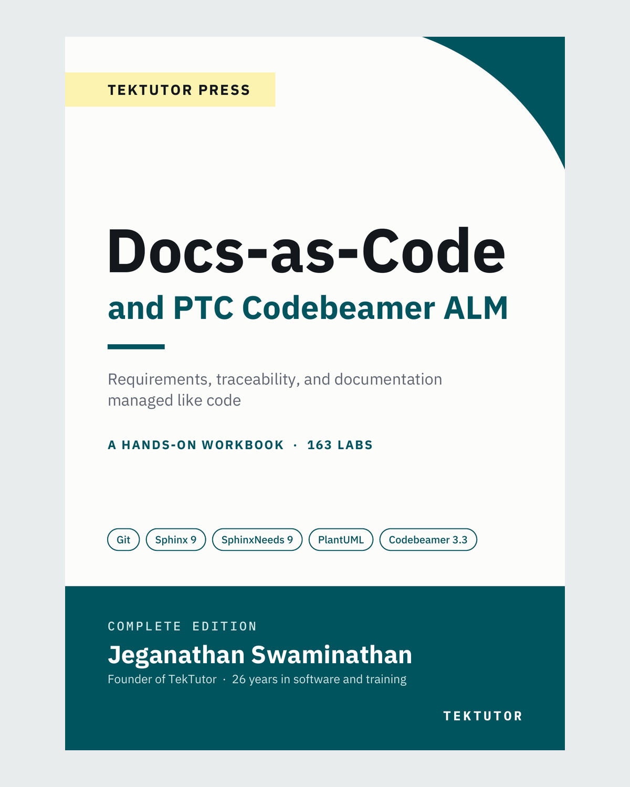

# Docs-as-Code Labs

File contents for each "Create" step are in the lab handout.


Docs-as-Code and PTC Codebeamer ALM, by Jeganathan Swaminathan (TekTutor Press)

## Lab 0: Setup

1. Install the system packages

```bash
sudo apt-get update
sudo apt-get install -y git make python3 python3-venv python3-pip \
  doxygen graphviz libenchant-2-2 hunspell-en-us g++ default-jdk-headless \
  poppler-utils plantuml latexmk texlive-latex-recommended \
  texlive-latex-extra texlive-fonts-recommended tex-gyre
```

2. Configure Git

```bash
git config --global user.name "Your Name"
git config --global user.email "you@example.com"
git config --global init.defaultBranch main
```

3. Create the project and the virtual environment

```bash
mkdir -p ~/dac-labs
cd ~/dac-labs
python3 -m venv .venv
source .venv/bin/activate
python -m pip install --upgrade pip
```

4. Create `requirements.txt`, then install

```bash
pip install -r requirements.txt
sphinx-build --version
```

5. Create `.gitignore`, then commit

```bash
git init
git add .gitignore requirements.txt
git commit -m "Setup: pinned Python packages"
```

Start every lab with:

```bash
cd ~/dac-labs
source .venv/bin/activate
```

## Lab 1: Sphinx Basics and PDF Generation

1. Create the docs folder

```bash
mkdir -p docs/_static
touch docs/_static/.gitkeep
```

2. Create `docs/conf.py`
3. Create `docs/index.rst`
4. Create `docs/overview.rst`
5. Build the HTML site

```bash
sphinx-build -b html docs docs/_build/html
xdg-open docs/_build/html/index.html
```

6. Build the PDF

```bash
sphinx-build -M latexpdf docs docs/_build
xdg-open docs/_build/latex/battery-monitor.pdf
```

7. Commit

```bash
git add docs
git commit -m "Lab 1: Sphinx project with HTML and PDF output"
```

## Lab 2: Sphinx-Needs Overview, Core Directives, Filtering and Visualization

1. Add the Sphinx-Needs settings to `docs/conf.py`
2. Create `docs/requirements/requirements.rst`
3. Create `docs/requirements/specifications.rst`
4. Create `docs/requirements/tests.rst`
5. Create `docs/traceability.rst`
6. Update `docs/index.rst`
7. Build

```bash
sphinx-build -E -b html docs docs/_build/html -W --keep-going -q
echo "exit code: $?"
```

8. Create `tools/page_text.py`, then read the pages

```bash
python tools/page_text.py docs/_build/html/requirements/requirements.html
python tools/page_text.py docs/_build/html/traceability.html "Requirement list"
```

9. Break a link, build, then restore

```bash
sed -i 's/:satisfies: REQ_SOC$/:satisfies: REQ_SOCC/' docs/requirements/specifications.rst
sphinx-build -E -b html docs docs/_build/html -W --keep-going -q
sed -i 's/REQ_SOCC/REQ_SOC/' docs/requirements/specifications.rst
sphinx-build -E -b html docs docs/_build/html -W --keep-going -q
```

10. Commit

```bash
git add docs tools
git commit -m "Lab 2: requirements, specifications, test cases and views"
```

## Lab 3: Sphinx-Needs for Real Work

1. Add the `issue` and `source` fields to `docs/conf.py`
2. Update `docs/requirements/requirements.rst`
3. Update `docs/requirements/tests.rst`
4. Update `docs/traceability.rst`
5. Create `docs/coverage.rst`
6. Add `coverage` to `docs/index.rst`

```bash
sed -i 's/^   traceability$/   traceability\n   coverage/' docs/index.rst
```

7. Build and read the pages

```bash
sphinx-build -E -b html docs docs/_build/html -W --keep-going -q
python tools/page_text.py docs/_build/html/traceability.html "Requirement to test matrix"
python tools/page_text.py docs/_build/html/traceability.html "Status roll-up"
python tools/page_text.py docs/_build/html/coverage.html
```

8. Commit

```bash
git add docs
git commit -m "Lab 3: matrix, roll-up, coverage gaps, issue and source links"
```

9. Break the issue ID, build, then restore

```bash
sed -i 's/:issue: BMS-102/:issue: bms-102/' docs/requirements/requirements.rst
sphinx-build -E -b html docs docs/_build/html -W --keep-going -q
git checkout -- docs/requirements/requirements.rst
```

## Lab 4: Continuous Integration for Documentation

1. Add the quality settings to `docs/conf.py`
2. Create the word list

```bash
printf '%s\n' mV req > docs/spelling_wordlist.txt
```

3. Run the checks

```bash
sphinx-build -b spelling docs docs/_build/spelling -W --keep-going -q
sphinx-build -E -b html docs docs/_build/html -W --keep-going -q
sphinx-build -b linkcheck docs docs/_build/linkcheck -q
cat docs/_build/linkcheck/output.txt
```

4. Commit

```bash
git add docs
git commit -m "Lab 4: nitpicky mode, spell check and link check"
```

5. Add the broken text to `docs/overview.rst`, run the 3 checks again, then restore

```bash
git checkout -- docs/overview.rst
```

6. Create the `Makefile`, then run all checks

```bash
make help
make clean
make check
```

7. Commit

```bash
git add Makefile
git commit -m "Lab 4: Makefile for all checks"
```

## Lab 5: Customizing Sphinx-Needs

1. Add the `risk` type, fields and links to `docs/conf.py`
2. Add the status function and the layout to `docs/conf.py`
3. Update `docs/requirements/requirements.rst`
4. Update `docs/requirements/tests.rst`
5. Link the specification to the risk

```bash
sed -i 's/^   :satisfies: REQ_LOW_WARN$/&\n   :mitigates: RISK_DEEP_DISCHARGE/' \
  docs/requirements/specifications.rst
```

6. Create `docs/requirements/risks.rst`
7. Update `docs/traceability.rst`
8. Build and check

```bash
make check
python tools/page_text.py docs/_build/html/requirements/risks.html
python tools/page_text.py docs/_build/html/coverage.html
```

9. Commit

```bash
git add docs
git commit -m "Lab 5: risk type, fields, links, computed status, layout"
```

10. Change the test results and rebuild

```bash
sed -i 's/:result: not_run/:result: pass/' docs/requirements/tests.rst
make html
python tools/page_text.py docs/_build/html/traceability.html "Requirement to test matrix"
git checkout -- docs/requirements/tests.rst
```

11. Add the PlantUML settings to `docs/conf.py`
12. Add the `pdf` target to the `Makefile`
13. Build the PDF

```bash
make pdf
xdg-open docs/_build/latex/battery-monitor.pdf
```

14. Commit

```bash
git add docs Makefile
git commit -m "Lab 5: PDF with PlantUML diagrams"
```

## Lab 6: CI/CD with GitHub Actions and Jenkins

1. Create `.github/workflows/docs.yml`
2. Validate the workflow

```bash
pip install actionlint-py
actionlint .github/workflows/docs.yml
```

3. Create `README.md`, then commit

```bash
git add .github README.md
git commit -m "Lab 6: GitHub Actions workflow and README badge"
```

4. Run the pipeline in a clean clone

```bash
rm -rf /tmp/ci-run
git clone ~/dac-labs /tmp/ci-run
cd /tmp/ci-run
python3 -m venv .venv
.venv/bin/pip install -r requirements.txt
PATH="/tmp/ci-run/.venv/bin:$PATH" make check
cd ~/dac-labs
```

5. Create the `Jenkinsfile`, then commit

```bash
git add Jenkinsfile
git commit -m "Lab 6: Jenkinsfile"
```

6. Push to GitHub

```bash
git remote add origin https://github.com/<your-account>/dac-labs.git
git push -u origin main
```

7. GitHub: Settings > Pages > Source: GitHub Actions
8. GitHub: Settings > Rules > Rulesets > New branch ruleset, require the `check` status checks
9. Test the merge gate

```bash
git switch -c broken-ref
printf '\nSee :doc:`no-such-page`.\n' >> docs/overview.rst
git commit -am "Break a reference on purpose"
git push -u origin broken-ref
git switch main
git branch -D broken-ref
```

10. Jenkins: New Item > Pipeline > Pipeline script from SCM > Git > your repository URL > Script Path: `Jenkinsfile`

## Fix: project inside the lab5 folder

Use this `.github/workflows/docs.yml`:

```yaml
name: docs

on:
  push:
    branches: [main]
  pull_request:
  workflow_dispatch:

permissions:
  contents: read

defaults:
  run:
    working-directory: lab5

jobs:
  check:
    name: check (Python ${{ matrix.python }})
    runs-on: ubuntu-24.04
    timeout-minutes: 20
    strategy:
      fail-fast: true
      matrix:
        python: ["3.12", "3.13"]
    steps:
      - uses: actions/checkout@v6

      - uses: actions/setup-python@v6
        with:
          python-version: ${{ matrix.python }}
          cache: pip
          cache-dependency-path: lab5/requirements.txt

      - name: Install system tools
        run: |
          sudo apt-get update
          sudo apt-get install -y --no-install-recommends \
            doxygen graphviz libenchant-2-2 hunspell-en-us \
            g++ default-jdk-headless

      - name: Install Python packages
        run: pip install -r requirements.txt

      - name: Run all checks
        run: make check

      - name: Link check
        if: matrix.python == '3.13'
        continue-on-error: true
        run: make linkcheck

  pdf:
    needs: check
    runs-on: ubuntu-24.04
    timeout-minutes: 30
    steps:
      - uses: actions/checkout@v6

      - uses: actions/setup-python@v6
        with:
          python-version: "3.13"
          cache: pip
          cache-dependency-path: lab5/requirements.txt

      - name: Install system tools
        run: |
          sudo apt-get update
          sudo apt-get install -y --no-install-recommends \
            doxygen graphviz plantuml default-jre-headless latexmk \
            texlive-latex-recommended texlive-latex-extra \
            texlive-fonts-recommended tex-gyre

      - name: Install Python packages
        run: pip install -r requirements.txt

      - name: Build PDF
        run: make pdf

      - uses: actions/upload-artifact@v7
        with:
          name: battery-monitor-pdf
          path: lab5/docs/_build/latex/battery-monitor.pdf
```

In the `Jenkinsfile`, wrap the steps of each stage in `dir('lab5') { ... }`.

```bash
git add .github/workflows/docs.yml Jenkinsfile
git commit -m "CI: build from lab5 on Python 3.12 and 3.13"
git push
```

## Lab 7: API Documentation for Python, C++ and Java

1. Create `src/python/battery/__init__.py` and `src/python/battery/monitor.py`

```bash
PYTHONPATH=src/python python -c "from battery import BatteryMonitor; m = BatteryMonitor(); m.update(11900); print(m.state_of_charge(), m.is_low())"
```

2. Create `tests/test_monitor.py`
3. Create `src/cpp/include/battery_monitor.hpp` and `src/cpp/src/main.cpp`
4. Create `src/java/com/tektutor/battery/BatteryMonitor.java`
5. Update the `Makefile`, then run the tests

```bash
make test code
```

6. Add the autodoc, Breathe and Exhale settings to `docs/conf.py`
7. Create `docs/api/index.rst`, `python.rst`, `cpp.rst` and `java.rst`
8. Add the new words to the word list

```bash
printf '%s\n' autodoc Doxygen impl isLow lowThresholdMv millivolts \
  namespace SOC Sphinx timestamp >> docs/spelling_wordlist.txt
sort -f -o docs/spelling_wordlist.txt docs/spelling_wordlist.txt
```

9. Run every check

```bash
make clean
make check
xdg-open docs/_build/html/api/index.html
```

10. Commit

```bash
git add .
git commit -m "Lab 7: API docs for Python, C++ and Java"
```

11. Rename a method, build, then restore

```bash
sed -i 's/def is_low/def is_battery_low/' src/python/battery/monitor.py
make html
git checkout -- src
make html
```

12. Build the PDF

```bash
make pdf
```

## Lab 8: Docs-as-Code Capstone

1. Add the specification to code matrix to `docs/traceability.rst`, then commit

```bash
git add docs
git commit -m "Add specification to code matrix and implementation gap"
```

2. Create a branch

```bash
git switch -c capstone-req-log
```

3. Add `format_sample` to `src/python/battery/monitor.py`
4. Add the test case to `docs/requirements/tests.rst` and `tests/test_monitor.py`
5. Run every check

```bash
make check
```

6. Add the offline fix to `docs/conf.py`
7. Record the passing test, then check again

```bash
sed -i 's/:result: not_run/:result: pass/' docs/requirements/tests.rst
make check
python tools/page_text.py docs/_build/html/coverage.html
```

8. Build the PDF

```bash
make pdf
```

9. Commit and merge

```bash
git add .
git commit -m "Capstone: implement and verify REQ_LOG"
git switch main
git merge --no-ff capstone-req-log -m "Merge capstone-req-log"
git push
```
## Post-test url
<pre>
https://forms.gle/qAgg5M8JcVN8Uh5v9
</pre>
