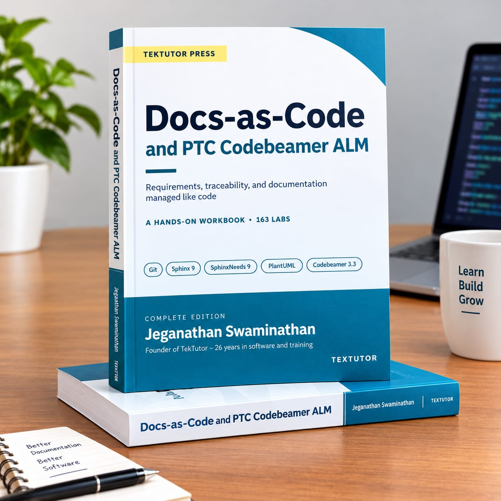

# docs-as-code-oct-2026

## Info - This course is based on my book


### Get the Book

This training follows my book, **Docs-as-Code and PTC Codebeamer ALM**. The labs in this
repository come from it, and the book goes further than what we cover in class.

You can use it to:

- Repeat every lab at your own pace after the training ends
- Read the full explanation behind each step we ran in class
- Work through topics we had no time for in the sessions
- Keep a reference on your desk when you set up Docs-as-Code and Codebeamer at work

#### Price
**Pages:** 574
**Rs. 3,500** per copy

#### How to order

- **Single copy:** Message me on WhatsApp at **+91 822-000-5626**. You order directly from me.
- **Bulk orders for your team:** Email **jegan@tektutor.org** to get the author discount.


## Info - Check if all the tools required are installed
```
cd ~/dac-labs

python3 -m venv ~/dac-venv
source ~/dac-venv/bin/activate

./check-toolchain.sh
```

